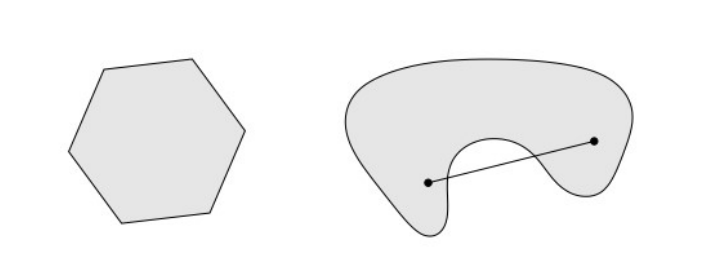
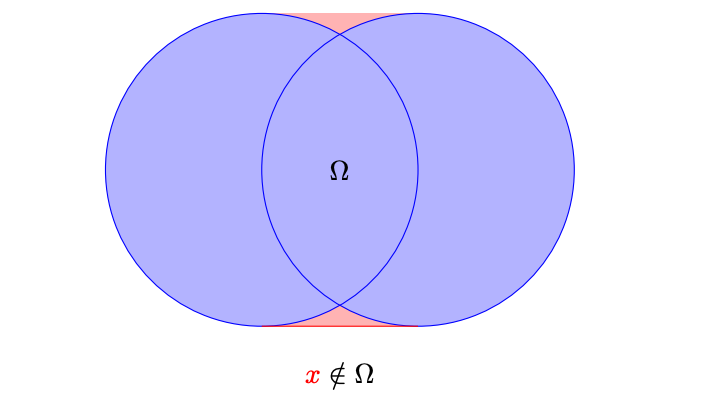
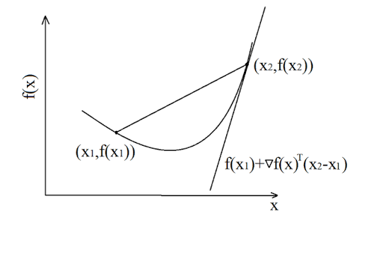
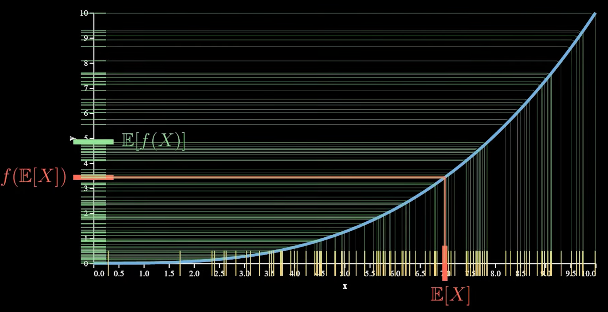

# Background Knowledge

[TOC]

## Optimization

### Convexity

Optimization problems are frequently of the form:

$$
\min_{x \in \Omega} f(x) \text{ s.t. } g(x) \geq 0
$$

where $f(x)$ is a loss function subject to (optional) constraint $g(x) \geq 0$. $f(x)$ is convex, $\Omega$ is some convex set and $g(x)$ is a convex function.

For example, regression tasks can be framed as follows: for $y \in \R$, find $f: X \to \R$ s.t. $f = \argmin_f \frac{1}{n} \sum_{i = 1}^n (y_i - f(x_i))^2$.

It is possible to take discrete, intractable problems to continuous space and optimize them there.

!!! info "Definition: Convex Set"
    $\Omega$ denotes a convex set if $\forall x, y \in \Omega$ and for any $t \in [0, 1], tx + (1 - t)y \in \Omega$. The line between two points in a convex set must also exist entirely in the convex set.

!!! info "Definition: Convex Function"
    $f: \Omega \to \R$ is a convex function iff $\Omega$ is a convex set and $\forall x, y \in \Omega$ where $t \in [0, 1]$, $f(tx + (1 - t)y) \leq tf(x) + (1 - t) f(y)$. Every point on the interpolation passed through $f$ lies below or on the interpolation of the end-points passed through $f$.

Equivalent characterizations - the function between two end-points lies beneath the secant line or the *epigraph* (set of points above the function) is a convex set.

!!! info "Definition: Local Minima"
    $\omega \in \Omega$ is a local minimum for convex function $f$ if $\forall u, ||\omega - u|| \leq \rho$ and $f(u) \geq f(\omega)$. Here, $\rho$ is a small threshold distance which defines a region around $\omega$. $u$ represents the set of points in the convex domain which fall inside that region.

!!! success "Proposition: Every Local Minima is a Global Minima for a Convex Function"
    Suppose $f$ is convex and $\omega^*$ is a local minima. Then, $\omega^*$ is a global minima for $f$.

!!! quote "Proof"
    Let $\omega_0$ be the global minima such that $f(\omega_0) < f(\omega^*)$. By convexity of $f$, we have that:

    $$
    f(t \omega_0 + (1 - t) \omega^*) \leq t f(\omega_0) + (1 - t) f(\omega^*)
    $$

    Since $f(\omega_0) < f(\omega^*)$,

    $$
    t f(\omega_0) + (1 - t) f(\omega^*) < t f(\omega^*) + (1 - t) f(\omega^*) = f(\omega^*)
    $$

    Since $\omega^*$ is a local minimum, there exists some region where $f(\omega^*) \leq f(u)$ for all $u$ where $||\omega^* - u || \leq \rho$. However, we also know that $f(t \omega_0 + (1 - t) \omega^*) \leq f(\omega^*)$.

    This is a contradiction. With a sufficiently high $t$, the point $u(t) = t \omega_0 + (1 - t) \omega^*$ can get arbitrarily close to $\omega^*$ meaning that for any $\rho$, we can find $t$ where $||\omega^* - u(t)|| \leq \rho$. By convexity, we know that $f(u(t)) < f(\omega^*)$. However, by the definition of local-minima, we know that $f(u(t)) \geq f(\omega^*)$. Therefore, the assumption that there must exist some $\omega_0$ where $f(\omega_0) < f(\omega^*)$ is false. The local minimum of a convex function must also be a global minimum.

Intuitively, there can be no purely local minima in a convex function. In order for a point to be in a local minima, it must be surrounded by some kind of valley. We could draw a chord between the local and global minima and the walls of the valley would exist above the chord violating the convexity assumption. This chord is called the **secant line**.

!!! success "Proposition: First Order Conditions for Local Minima"

    - $x$ is a local minima iff $\nabla f(x) = 0$ and there are no other constraints. This is a necessary and sufficient condition for local minima under the assumption that $f(x)$ is convex. If $f(x)$ isn't convex, this is just a necessary condition.
    - $x$ is a local minima if for all $y \in \Omega$, $\nabla f(y)^T (y - x) \geq 0$. Moving from $x$ to any other feasible point does not decrease the value of the function.

The second condition - pick any point. Look at the gradient of $f$ evaluated at that point and the difference vector with the local minima. The two will point in the same direction.

### Convex Sets

Recall that we say a set is convex if the line segment between any two points $x, y \in \Omega$ lies within $\Omega$.

In the right set, you can draw a chord which goes outside the set so the set is not convex.

Formally, $\Omega$ is convex if $\forall x, y \in \Omega$ and for any $t \in [0, 1], tx + (1 - t)y \in \Omega$.

!!! info "Definition: Convex Hull"
    The convex hull is the set of all convex combinations of points in a set $C$.

    $$
    \text{conv } C = \left \{ a_1 x_1 + \dots + a_k x_k \mid x_i \in C, a_i \geq 0, \sum_{i = 1}^k a_i = 1 \right \}
    $$

Naturally, the convex hull is always convex and it is the smallest convex set that contains $C$.

We list examples of convex sets.

!!! example "Example: Convex Sets"

    - The $l_2$-Ball. Formally, $B(r) = \{x: ||x||_2 \leq r\}$.

    - The Half-space in $d = 2$. $\{Ax + b \leq 0\} \in \R^d$.

    - The Simplex. $\Delta = \{P \mid P \geq 0, \sum_{i = 1}^d P_i = 1\}$.

Convexity is preserved under intersection. If $S_1, S_2$ are convex then $S_1 \cap S_2$ is convex.

Affine functions preserve convexity. $C = A \Omega + b$.

Linear fractions preserve convexity.

Unions however do not preserve convexity.

### Convexity Conditions

!!! tip "Theorem: First Order Conditions"
    Recall that $f$ is convex iff $\forall x, y \in \Omega$,

    $$
    f(x) \geq f(y) + \nabla f(y)^T (x - y)
    $$

$f(x) \geq f(y) + \nabla f(y)^T (x - y)$ is just saying that a convex function is bounded below by its tangent line (while it is bounded above by its secant line) as the RHS is the first-order Taylor approximation of $f$ around $y$ evaluated at $x$.

{ .center }

!!! quote "Proof"
    Suppose $x_0 = tx + (1 - t)y$. We know that $f(x) \geq f(x_0) + \nabla f(x_0)^T (x - x_0)$ and $f(y) \geq f(x_0) + \nabla f(x_0)^T (y - x_0)$. WTS $f$ is convex.

    Then (the following three equations are independent),

    $$
    t f(x) + (1 - t) f(y) \geq t (f(x_0) + \nabla f(x_0)^T (x - x_0)) + (1 - t) (f(x_0) + \nabla f(x_0)^T (y - x_0))
    $$

    $$
    t f(x_0) + (1 - t) f(x_0) = f(x_0)
    $$

    $$
    t(x - x_0) + (1 - t)(y - x_0) = tx + (1 - t)y - x_0
    $$

    However, note that $x_0 = tx + (1 - t)y$ so the vector being multiplied against the inner-product is $0$. Therefore,

    $$
    t f(x) + (1 - t) f(y) \geq f(tx + (1 - t)y)
    $$

    Therefore, $f$ is convex.

    Next, we prove the other direction. Suppose that $f(tx + (1 - t)y) \leq t f(x) + (1 - t) f(y)$. WTS that $f(x) \geq f(y) + \nabla f(y)^T (x - y)$.

    Then,

    $$
    \frac{f(tx + (1 - t)y)}{t} \leq f(x) - f(y) + \frac{f(y)}{t}
    $$

    $$
    f(x) \geq f(y) + \frac{f(tx + (1 - t)y) - f(y)}{t}
    $$

    In the limit as $t \to 0$, this becomes:

    $$
    f(x) \geq f(y) + \nabla f(y)^T(x - y)
    $$

!!! tip "Theorem: Second Order Condition"
    Given $\Omega \in \R^d$, $f$ is convex iff $\forall x \in \Omega$,

    $$
    \nabla^2 f(x) \geq 0
    $$

    or for all $h \in \R^d, x \in \Omega$,

    $$
    h^T \nabla^2 f(x) h \geq 0
    $$

    where $\nabla^2 f$ is the Hessian of $f$.

!!! quote "Proof"

    Suppose $\nabla f(x)$ is PSD. Then, Taylor's approximation yields

    $$
    f(x + h) \approx f(x) + h^T \nabla f(x) + \frac{1}{2} h^T \nabla^2 f(x) h
    $$

    Since $\nabla^2 f(x)$ is PSD, it follows that the last term is larger than $0$. So:

    $$
    f(x + h) \geq f(x) + h^T \nabla f(x)
    $$

#### Jensen's Inequality

Jensen's Inequality is an incredibly useful inequality.

!!! info "Definition: Jensen's Inequality"
    Let $f$ be convex. Then,

    $$
    f(\E_p[x]) \leq \E_p[f(x)]
    $$

If $f$ is linear, clearly, the two would be identical. However, since $f$ is convex, it *pulls* upwards meaning that the average of the outputs is greater than the output of the average.

{ .center }

!!! quote "Proof"
    Jensen's inequality is the generalization of convexity to convex combinations. We proceed via induction.

    The base case is simply the definition of convexity.

    Now suppose Jensen's inequality holds for $n - 1$ points. Then,

    $$
    p_1 x_1 + \dots + p_n x_n = p_n x_n + (1 - p_n) \hat{x}
    $$

    where $\hat{x} = \sum_{i = 1}^{n - 1} \frac{p_i}{1 - p_n} x_i$. By convexity,

    $$
    f(p_n x_n + (1 - p_n) \hat{x}) \leq p_n f(x_n) + (1 - p_n) f(\hat{x})
    $$

    Now, we can apply our induction hypothesis to $f(\hat{x})$.

    $$
    f(\hat{x}) \leq \sum_{i = 1}^{n - 1} \frac{p_i}{1 - p_n} f(x_i)
    $$

    Therefore,

    $$
    f(\sum_{i = 1}^n p_i x_i) \leq \sum_{i = 1}^n p_i f(x_i)
    $$

### Convex Functions

1. Affine Functions, $f(x) = a^T x + b$ can be shown to be convex using the second-order condition.

2. Quadratic functions, $f(x) = x^T Q x + b^T x + c$ where $Q$ is symmetric PSD. Can also be shown to be convex using the 2nd order condition.

3. Vector norms, $$||x||_p = \left ( \sum_{i = 1}^d |x_i|^p \right )^{1/p}$ where $p \geq 1$. Proof is given below.

4. $\text{Tr}(Ax)$ where $A \in \R^{p \times d}, x \in \R^{d \times p}$. This is convex since the trace is a linear function.

5. Matrix norms: $||x||_{\text{op}} = \lambda_{\text{max}}(x)$.

6. Frobenius Norm: $||A||_F = \sqrt{\text{Tr}(A^T A)}$.

7. LogSumExp: $f(x) = \log \sum_{i = 0}^n \exp(x_i)$.

We prove vector norms are convex.

!!! quote "Proof"
    By the triangle inequality and zeroth order convexity condition (definition of convexity),

    $$
    ||tx + (1 - t)y||_p \leq ||tx||_p + ||(1 - t)y||_p = t ||x||_p + (1 - t) ||y||_p
    $$

    Therefore,

    $$
    ||tx + (1 - t)y||_p \leq t ||x||_p + (1 - t) ||y||_p
    $$

We prove that LogSumExp is convex.

!!! quote "Proof"
    $$
    \nabla f(x) = \left [  \frac{\exp(x_i)}{\sum_{i = 1}^n \exp(x_i)}    \right ]
    $$

    The gradient is a probability distribution. Let $p_i = \nabla f(x_i)$. Then, use the quotient rule to find that:

    $$
    \frac{\partial^2 f}{\partial x_i \partial x_i} = p_i - p_i^2
    $$

    $$
    \frac{\partial^2 f}{\partial x_j \partial x_i} = - p_i p_j
    $$

    Element-wise, $H(f(x)) = \text{diag}(p) - pp^T$.

    This is a covariance matrix of a one-hot vector that equals $e_i$ with probability $p_i$. Covariance matrices are PSD so $f(x)$ is convex.

### Convexity Preserving Operations

1. Non-negative weighted sum of convex functions: $f(x) = \sum_{i = 1}^n \alpha_i f_i(x)$ where $\alpha_i \geq 0, f_i$ is convex.

2. Letting $n \to \infty$ and $\sum_i \alpha_i = 1$, this becomes an expectation function, $g(x) = \E_{\alpha}[f(x_i)]$.

3. The max operation is convex.

4. Composite functions. $g(x) = f(h(x))$. If $f$ is convex, strictly increasing and $h$ is convex, then $g$ is convex. If $f$ is convex, strictly decreasing and $h$ is concave, then $g(x)$ is convex.

As an application, we derive the variational lower-bound for maximum likelihood estimation.

#### Variational Lower Bound

Suppose $p(x, z) = p(x \mid z) p(z)$. We wantn to use MLE to maximize $\log p(x)$.

$$
L(z) = - \sum_{i = 1}^n \log p(x)
$$

$$
= - \sum_{i = 1}^n \log \int_z p(x, y) dz
$$

$$
= - \sum_{i = 1}^n \log \int_z \frac{p(x_i, z)}{q(z \mid x_i)} q(z \mid x_i) dz
$$

A log function is concave so negative log is convex. By Jensen's inequality, we know that $f(\E[x]) \leq \E[f(x)]$. Therefore,

$$
L(z) \leq \min_q \sum_{i = 1}^n - \E_{q(z \mid x)} \log p(x_i, z) - \log q(z \mid x_i)
$$

## Density Parameterization

Convex optimization via methods like gradient descent are *solvers* for Machine Learning but *density parameterization* is a *modeler* for Machine Learning.

### Canonical Form
We introduce a base measure $h(x)$. Then, we introduce a sufficient statistic $T(x)$ which is used in conjunction with the partition function to express the density. The following form is called the *canonical form* of an *exponential family*.

!!! info "Definition: Exponential Family"
    $$
    p(x) = h(x) \exp(\eta^T T(x) - A(\eta))
    $$

    Here $\eta$ parameterizes the distribution, $T(x)$ is the sufficient statistic, and $h(x)$ is the base measure.

!!! info "Definition: Log Partition"
    $A(\eta)$ is the log partition function defined as:

    $$
    A(\eta) = \log \int \exp(\eta^T T(x)) dx
    $$

    Then,

    $$
    \int p(x) dx = \int h(x) \exp(\eta^T T(x)) \cdot \exp(- A(\eta)) dx
    $$

    $\exp(\eta^T T(x))$ and $\exp(-A(\eta))$ cancel out so the integrand becomes $h(x)$ and the density integrates to $1$.

    Since,

    $$
    \int p(x) dx = 1 = \left [ \int h(x) \exp(\eta^T T(x)) dx \right ] \exp(A (\eta))
    $$

    Then,

    $$
    \int h(x) \exp(\eta^T T(x)) dx  = \exp(A(\eta))
    $$

### Conditional Distribution Modeling

We now give some examples of distributions. We model the conditional Gaussian for regression:

$$
y \mid x, \omega \sim \mathcal{N}(\omega^T x, \sigma^2)
$$

Then,

$$
P(y \mid x, \omega) = \frac{1}{\sqrt{2 \pi \sigma}} \exp \left ( - \frac{1}{2 \sigma^2} (y - \omega^T x)^2 \right )
$$

Then, maximizing the log-likelihood becomes:

$$
\text{MLE} = \min_{\omega} \sum_{i = 1}^n ||y_i - \omega^T x_i||^2
$$

We can also model classification using a Bernoulli distribution:

$$
y \mid x, \omega \sim \text{ Bernoulli}(p)
$$

$$
p = \frac{1}{1 + \exp(\omega^T x)}
$$

Then,

$$
P(y \mid p) = p^y (1 - p)^{1 - y}
$$

### Members of Exponential Family

We now show that the Bernoulli distribution is in the exponential family.

$$
p(x) = \pi^x (1 - \pi)^{1 - x}, / \pi \in \{0, 1\}
$$

Then,

$$
p(x) = \exp(x \log \pi + (1 - x) \log (1 - \pi))
$$

$$
p(x) = \exp \left ( x \log \frac{\pi}{1 - \pi} + \log (1 - \pi) \right )
$$

Here, $T(x) = x, \eta = \log(\pi / (1 - \pi)), h(x) = 1$.

Now, the Gaussian.

$$
p(x) = \frac{1}{\sqrt{2 \pi \sigma^2}} \exp( - \frac{(x - \mu)^2}{2 \sigma^2})
$$

$$
p(x) = \exp \log \left ( \frac{1}{\sqrt{2 \pi \sigma^2}} \exp( - \frac{(x - \mu)^2}{2 \sigma^2}) \right )
$$

$$
p(x) = \exp \left ( - \frac{(x - \mu)^2}{2 \sigma^2} - \log \sqrt{2 \pi \sigma^2} \right )
$$

$$
p(x) = \exp \left ( - \frac{x^2 - 2 x \mu + \mu^2}{2 \sigma^2} - \log \sqrt{2 \pi \sigma^2} \right )
$$

Here, $h(x) = 1, T(x) = [x^2, x], \eta = [- \frac{1}{2 \sigma^2}, \frac{\mu^2}{\sigma^2}]$. Then,

$$
A(\eta) = -\frac{\mu^2}{2 \sigma^2} - \log \sqrt{2 \pi \sigma^2}
$$

### Log Partitions, MLE

The log partition function $A(\eta)$ has important properties. Let's first take its derivative:

$$
\frac{dA(\eta)}{d\eta} = \frac{d}{d\eta} \log \int \exp(\eta^T T(x)) dx
$$

Let's assume that differentiating through the integral is allowed (dominated convergence theorem). Then,

$$
\frac{dA(\eta)}{d\eta} = \frac{\int \frac{d}{d\eta} \exp(\eta^T T(x)) dx}{\int \exp(\eta^T T(x)) dx}
$$

$$
= \frac{\int T(x) \exp(\eta^T T(x)) dx}{\exp(A(\eta))}
$$

$$
= \int T(x) \frac{\exp(\eta^T T(x))}{\int \exp(\eta^T T(x)) dx}
$$

$$
= \E_{\eta}[T(x)] = \int p_{\eta}(x) T(x) dx
$$

where

$$
p_{\eta}(x) = \exp(\eta^T T(x) - A(\eta))
$$

Taking the second derivative provides:

$$
\frac{d^2A(\eta)}{d\eta_a d\eta_b} = \int \frac{d}{d\eta_b} p_{\eta}(x) T_a(x) dx
$$

Then,

$$
\frac{d}{d \eta_b} p_{\eta}(x) = p_{\eta}(x) (T_b(x) - \E_{\eta}[T_b(x)])
$$

$$
\frac{d^2A(\eta)}{d\eta_a d\eta_n} = \int T_a(x) p_{\eta}(x) (T_b(x) - \E_{\eta}[T_b(x)]) dx
$$

$$
= \int p_{\eta}(x) T_b(x) T_a(x) - p_{\eta}(x) T_a(x) \E_{\eta}[T_b(x)]
$$

$$
= \E_{\eta}[T_a(x) T_b(x)] - \E_{\eta}[T_a(x)] \E_{\eta}[T_b(x)]
$$

$$
= \text{Cov}(T_a(x), T_b(x))
$$

Thus, we can infer two important properties.

First, since the 2nd-order derivatives form a covariance matrix, the Hessian of the log-partition function is PSD (the second-order condition for convexity). Therefore,the log-partition function is convex w.r.t. the natural parameter $\eta$.

$$
A(t \eta_1 + (1 - t)\eta_2) \leq t A(\eta_1) + (1 - t) A(\eta_2)
$$

Second, the $k$'th order derivative of the log partition function is the $k$'th cumulant of the partition function.

## Sampling

We review sampling very briefly.

### Motivation

Consider the supervised learning setting. Bayes rule states that:

$$
p(\theta \mid D) = \frac{p(D \mid \theta) p(\theta)}{p(D)}
$$

where $\theta$ is our parameter set and $D$ is a dataset. $p(\theta)$ is a prior over $\theta$, $p(D)$ is the marginal likelihood / partition function, $p(D \mid \theta)$ is the likelihood and $p(\theta \mid D)$ is the posterior distribution.

Assuming i.i.d.'ness of the dataset $D$, the likelihood is:

$$
p(D) = \prod_{i = 1}^n p(y_i \mid x_i, \theta)
$$

Then,

$$
p(D) = \int_{\theta} p(D, \theta) d\theta = \int \prod_{i = 1}^n p(y_i \mid x_i, \theta) p(\theta) d\theta
$$

The posterior probability for $\theta$ is:

$$
p(\theta \mid \{x_i, y_i\}_{i = 1}^n) = \frac{\prod_{i = 1}^n p(y_i \mid x_i, \theta)}{\int \prod_{i = 1}^n p(y_i \mid x_i, \theta) p(\theta) d\theta}
$$

Given some $x_{\text{test}}$, we can derive the *posterior predictive distribution* as:

$$
p(y_{\text{test}} \mid x_{\text{test}}, D) = \int_{\Theta} p(y_{\text{test}}, \theta \mid x_{\text{test}}, D) d\theta
$$

$$
= \int_{\Theta} p(y_{\text{test}} \mid \theta, x_{\text{test}}, D) p(\theta \mid x_{\text{test}}, D) d\theta
$$

$$
= \int_{\Theta} p(y_{\text{test}} \mid \theta, x_{\text{test}}) p(\theta \mid D) d\theta
$$

This integral is very hard to compute since for modern models, we have billions or even trillions of parameters. Thus, we need to find some way to sample $\theta \mid D$ to compute an estimate of the expected posterior prediction.

### Monte Carlo

We want to estimate $\E_p[f(x)] = \int f(x) p(x) dx$.

!!! info "Definition: Monte Carlo Approximation"

    Sample points $x_i \sim p(x)$ such that $\sum_{i = 1}^n f(x_i) \approx \E_p[f(x)]$.

!!! quote "Important: Properties"
    The Monte Carlo estimator has good properties. Specifically, it is

    1. **Unbiased**

        $$
        \E[\frac{1}{k} \sum_{i = 1}^k f(x_i)] = \frac{1}{k} \sum_{i = 1}^k \E[f(x_i)] = \E_p[f(x)]
        $$

        All that we require for unbiasedness is identically distributed $x$'s, i.e. each $x_i \sim p(x)$.

    2. **Adheres to LLN**

        $$
        \lim_{k \to \infty} \frac{1}{k} \sum_{i = 1}^k f(x_i) =^{\text{a.s.}} \E_p[f(x)]
        $$

        This requires *almost sure convergence*.

    3. **Variance tends to $0$**

        $$
        \text{Var}[\frac{1}{k} \sum_{i = 1}^k f(x_i)] = \frac{1}{k^2} \sum_{i = 1}^K \text{Var}(f(x_i)) = \frac{1}{k} \text{Var}(f(x))
        $$

        This requires that the $x$'s are identically *and* independently distributed.

### Basic Sampling

I have learned about sampling techniques in a previous machine learning course so I have copied-and-pasted my notes here.

#### Inverse Probability Transform

If we know the inverse CDF of some distribution, then we can sample randomly from that distribution by using transformed samples from a uniform distribution.

If we think of the CDF of a Gaussian distribution, most of the probability density is concentrated around the mean. So the CDF will "jump" near the mean, going from a low value to a high value. Say we we sample uniformly from $[0, 1]$ on the y-axis and walk rightwards until we hit the CDF curve, and then go straight down. We're most likely to hit the CDF curve along the mostly vertical span which, on the $x$-axis, constitutes sample points near the mean.

This is nice but requires knowing $F^{-1}$ of the distribution we wish to sample from which is burdensome.

#### Rejection Sampling

**Rejection sampling** is essentially sampling from some easy-to-sample-from **proposal distribution** $q(x)$ which "covers" our target distribution $\tilde{p}(x)$. Specifically, we want $\tilde{p}(x) \leq k q(x)$ for all $x$.

- Sample $x_0 \sim k q(x)$.
- Sample $y_0 \sim \text{Uniform}[0, kq(x_0)]$.
- Accept $x_0$ if $y_0 \leq \tilde{p}(x_0)$

Basically, we know and can sample from $k q(x)$. By only sampling from the subset of $k q(x)$ corresponding to $\tilde{p}(x)$ in proportion to the height of $\tilde{p}(x)$, we can drawn samples proportionally to $p(x)$.

Rejection Sampling is a **exact-sampling procedure** which means the samples it draws exactly follow the target probability distribution.

Naturally, the proposal distribution must be chosen well and the constant $k$ must be chosen well. However, this method suffers from the curse of dimensionality in that the reject rate increases with the dimension. The accept rate can be computed as the fraction of the area occupied by $\tilde{p}(x)$ divided by the total are from which we are sampling. So we have

$$
    p(\text{Accept}) = \frac{\int \tilde{p}(x) \ dx}{\int k q(x) \ dx} = \frac{\int \tilde{p}(x)}{k}
$$

Now assume that $\tilde{p}(x)$ is normalized and that both distributions are multi-variate Gaussians, i.e. $q(x) \sim \mathcal{N}(\mu, \sigma_q^{\frac{d}{2}} I ), p(x) \sim \mathcal{N}(\mu, \sigma_p^{\frac{d}{2}} I)$ and $\sigma_q^{\frac{d}{2}} \geq \sigma_p^{\frac{d}{2}}$. Then, we have:

$$
    p(\text{Accept}) = \frac{\int p(x)}{\int q(x)} = \frac{(2 \pi \sigma_p^2)^d}{(2 \pi \sigma_q^2)^d} = \frac{\sigma_p^{2d}}{\sigma_q^{2d}} \implies k = \left ( \frac{\sigma_q}{\sigma_p} \right )^D
$$

As $D$ increases to many dimensions (i.e. if we want to sample from the posterior distribution of some neural network), the probability of acceptance decreases very quickly.

#### Importance Sampling

One could view rejection sampling as wasteful given that it discards many samples. **Importance sampling** gives us a very flexible method for dealing with this problem by essentially assigning weights to samples.

We can write:

$$
\begin{align}
    \int f(x) p(x) \ dx &= \int f(x) \frac{p(x)}{q(x)} q(x) \ dx \\
    &\approx \frac{1}{J} \sum_{j = 1}^J \frac{p(x^{(j)})}{q^{(j)}} f(x^{(j)}) \\
    E_p[f(x)] &\approx E_q[f(x) w(x)], w(x) = \frac{p(x)}{q(x)}
\end{align}
$$

Basically, the weights are related to how far the sample's probability density is from the boundary between $p(x)$ and $q(x)$.

It is not necessary that $q(x)$ be bigger than $p(x)$ for all $x$.

The weakness of this method is that the **proposal distribution** must be chosen extremely carefully.

#### Ancestral Sampling

**Ancestral Sampling** is essentially sampling from a Bayes net. We have some joint distribution which we specify a partial ordering on.

$$
p(a, b, c, d) = p(a) p(b) p(c \mid a, b) p(d \mid c)
$$

The algorithm is extremely simple:

- Sample from the marginal distributions.
- Conditioned on the nodes parent, sample from the nodes

This eventually gives us a sample from the joint distribution.

### MCMC

I didn't write down notes for this but I don't want to do it again. But here are 3 techniques.

#### Metropolis Hastings

#### Gibbs Sampling

#### Slice Sampling

