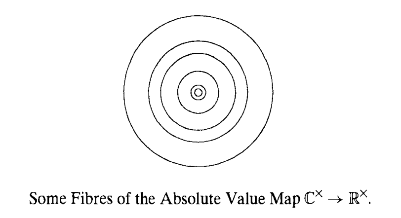
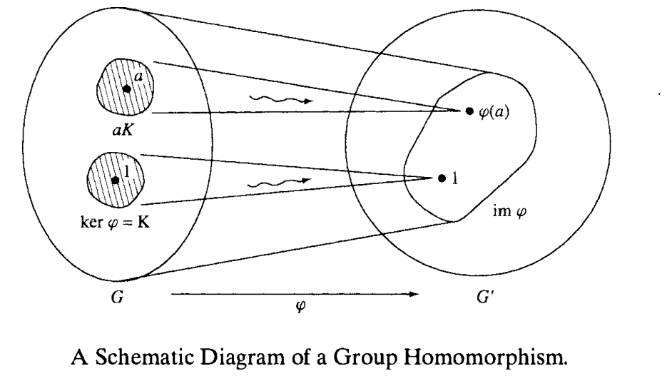

# Groups

[TOC]

## Definitions, Examples

!!! info "Definition: Law of Composition"
    A law of composition is a binary function:

    $$
    S \times S \to S
    $$

    This law is *associative* if $(ab)c = a(bc)$. The law is *commutative* if $ab = ba$. Associativity is more fundamental than commutativity because it relates to function composition.

!!! info "Definition: Group"
    A group is a set $G$ with a binary operation on $G$ with the following properties.

    - The operation is associative, $(ab)c = a(bc)$ for all $a, b, c \in G$.
    - $G$ has an identity element $1$ such that $1a = a1 = a$ for all $a \in G$.
    - For each $a$ in $G$, there exists an inverse element $b$ such that $ab = 1$.

Associativity, identity, and invertibility - that's all a group is. Naturally, the inverse of the identity is also the identity.

An *abelian group* is one whose operation is also commutative.

!!! example "Example: Groups"

    - $\mathbb{R} / \{0\}$ forms an abelian group under multiplication. Multiplication is associative, invertible (under exclusion of $0$) and the identity is $1$.
    - $\mathbb{R}$ forms an abelian group under addition. Addition is associative, invertible (via subtraction), and the identity is $0$.
    - The set of invertible $n \times n$ matrices forms a group under matrix multiplication. It's associative, invertible and the identity matrix is the identity. This is called the *general linear group*.

The order of a group $G$ is the number of elements it contains denoted by $|G|$. If $|G|$ is finite, then $G$ is a *finite group*. Otherwise, $G$ is an infinite group.

!!! tip "Theorem: Cancellation Law"
    Let $a, b, c$ be elements of a group $G$. If $ab = ac$ or $ba = ca$, then $b = c$. This is a direct consequence of the inverse.

Groups can also be obtained by excluding elements that are not invertible.

- $\text{GL}_n(\mathcal{F}) = \{A \in \mathcal{F}^{n \times n} | \det(A) \neq 0\}$. This is the $n \times n$ general linear group - the group of all invertible $n \times n$ matrices. We can write $\text{GL}_n(\mathbb{R})$ or $\text{GL}_n(\mathbb{C})$ to indicate if we are working with real or complex matrices.
- Let $M$ be the set of maps from a set $T$ to itself. A map $f: T \to T$ has an inverse iff it is bijective - in other words, $f$ is a *permutation* of $T$. These permutations form a group where the binary op. is function composition. The group of permutations of index set $\{1, 2, \dots, n\}$ is called the *symmetric group* written like $S_n$. $|S_n| = n!$.

!!! quote "Important: "
    The elements of a permutation group are the permutations, not the set of indices.

## Permutation Groups

### Cyclic Notation

To write down a permutation, we typically use *cycle notation*. Consider the output of some permutation $p$ to be

$$
p = \begin{bmatrix}
1 & 2 & 3 & 4 & 5 \\
3 & 5 & 4 & 1 & 2
\end{bmatrix}
$$

$p$ maps each element in the upper row to the matching element in the bottom row. Writing the output of each permutation makes it a nightmare to track composition of permutations (which is what we really care about).

Instead, we use cycle notation. Pick some index, say $3$. $p(3) = 4$. $p(4) = 1$. $p(1) = 3$. So we have a cycle $(3, 4, 1)$. Since $p(2) = 5$ and $p(5) = 2$, we can write:

$$
p = (3 \ 4 \ 1) (2 \ 5)
$$

Basically, an index within a cycle gets mapped to the next element.

Consider $q = (1 \ 4 \ 5 \ 2)$. We want to compute $q \circ p$. In function composition, the inner function is applied first. So consider an index $1$. By $p$, $1$ gets mapped to $3$ and $q$ leaves $3$ alone. $p(3) = 4$ and $q(4) = 5$. $p(5) = 2$ and $q(2) = 1$. So we have the chain:

$$
q \circ p = (1 \ 3 \ 5)
$$

where the omitted $2$ and $4$ means that those indices are left alone (which is easily verifiable).

Consider $S_2 = \{a, b\}$. All we can do is either apply the identity $i$ or transpose $\tau$. Since there are only two permutations, our group has order two.

Consider $S_3$. This is the smallest group whose binary operation isn't commutative. Pick two permutations - the cyclic permutation $x = (1, 2, 3)$ and the transposition $(1, 2)$. We have $x^3 = 1$ and $y^2 = 1$ (following the cycle).

It's also easily verifiable that $yx = x^2y$. $x^3 = 1 \implies x \circ x^2 = 1 \implies x^2 = x^{-1}$. Let's multiply both sides by $y$. We get $x^2 y = x^{-1} y$.

$$
\begin{aligned}
x^{-1} &= (3 \ 2 \ 1) \\
y &= (1 \ 2) \\
x^{-1} y &= (2 \ 3)
\end{aligned}
$$

$$
\begin{aligned}
y &= (1 \ 2) \\
x &= (1 \ 2 \ 3) \\
yx &= (2 \ 3)
\end{aligned}
$$

So $x^2 y = yx$.

Thus our group is:

$$
S_3 = \{1, x, x^2, y, xy, x^2 y\}
$$

Any product of elements $x, y$ can be shown to be equal to an element of $S_3$.

$$
x^{-1} y^3 x^2 y = x^2 y^3 y x = x^2 y^4 x = x^3 = 1
$$

These rules are called the *defining relations* for the group.

### Permutation Signs

Any permutation $p$ can be associated with a permutation matrix $P$. Left-multiplicaiton by this matrix permutes the entries of a vector $X$ using the permutation.

Consider $p = (1 \ 2 \ 3)$ and associated matrix $P$. Then,

$$
PX = \begin{bmatrix}
0 & 0 & 1 \\
1 & 0 & 0 \\
0 & 1 & 0
\end{bmatrix}
\begin{bmatrix}
x_1 \\ x_2 \\ x_3
\end{bmatrix} = \begin{bmatrix}
x_3 \\ x_1 \\ x_2
\end{bmatrix}
$$

!!! success "Proposition: Permutation Matrices"
    - Any matrix with a single $1$ per row and column is a permutation matrix (and vice versa).
    - The determinant of a permutation matrix is $\pm 1$.
    - Let $p, q$ be permutations with associated $P, Q$. Then, $pq$ has associated matrix $PQ$.

!!! info "Definition: Sign"
    The *sign* of a permutation is:

    $$
    \text{sign}(p) = \det P = \pm 1
    $$

    $p$ is *even* if its sign is $1$ and *odd* if its sign is $-1$.

## Subgroups

The general linear group and symmetric groups are important because many other groups are included in them as subgroups.

!!! info "Definition: Subgroup"
    A subset $H$ of group $G$ is called a *subgroup* if

    - *Closure*. If $a, b \in H$, then $ab \in H$.
    - *Identity*. $1 \in H$.
    - *Inverses*. $a \in H \implies a^{-1} \in H$.

The first condition states that the law of composition on $G$ induces a law of composition on $H$. The other conditions state that $H$ is a group w.r.t. the induced law.

!!! example "Example: Subgroups"
    - The group of $n \times n$ real matrices with determinant $1$ is a subgroup of the general linear group $\text{GL}_n(\mathbb{R})$. This is called the *special linear group*, $\text{SL}_n(\mathbb{R})$.
    - Complex numbers of absolute value $1$ are the set of points on the unit circle in the complex plane. It's a subgroup of the multiplicative group $\mathbb{C}^{\times}$ called the *circle group*.

Each group $G$ has two obvious subgroups - the group $G$ itself and the *trivial* subgroup containing just the identity element. A subgroup is called a *proper subgroup* if its neither of these two.

!!! tip "Theorem: Subgroups of Additive Groups of Integers"
    Let $S$ be a subgroup of the additive group $\mathbb{Z}^{+}$. Either $\mathbb{Z}$ is the trivial subgroup $\{0\}$ of it has the form $\mathbb{Z}a$ where $a$ is the smallest positive integer in $S$. Here,

    $$
    \mathbb{Z}a = \{n \in \mathbb{Z} \mid n = ka, k \in \mathbb{Z}\}
    $$

!!! quote "Proof"
    Let $S$ be a subgroup of $\mathbb{Z}^{+}$. Then, $0 \in S$. If $S = \{0\}$, then its the trivial subgroup. Othherwise, there exists at least two more integers, namely $n$ and $-n$. WLOG, suppose $n > 0$. We now show that $S = \mathbb{Z}a$ where $a$ is the smallest positive integer in $S$. The way to show two sets are equivalent is to show that they are subsets of one another.

    First, we show that $\mathbb{Z}a \subseteq S$, namely that $ka \in S$ for every integer $k$. If $k > 0$, then $ka = (a + \dots + a)$ which is in $S$ under closure. If $k = 0$, then $ka = 0 \in S$. If $k < 0$, then $-ka \in S$ so by the inverse property of $S, ka \in S$. Therefore, $ka \in S$.

    Next, we show that $S \subseteq \mathbb{Z}a$, i.e. every element $n \in S$ is an integer multiple of $a$, the smallest positive integer in $S$. Consider an arbitrary element $n \in S$. By the division theorem, we have $n = qa + r$ where $0 \leq r < a$. Naturally, $qa \in \mathbb{Z}a$ since $a \mid qa$. Since $\mathbb{Z}a \subseteq S$, it follows that $qa \in S$ as well. Since $n, qa \in S$, it follows that $n - qa = r$ is also in $S$ as $S$ is closed under addition and has an inverse. Therefore, $r \in S$. Since $a$ is the smallest positive integer in $S$ and $0 \leq r < a$, $r = 0$ and $n = qa \implies n \in \mathbb{Z}a$.

    Therefore, $S = \mathbb{Z}a$.

This theorem is quite strong - every possible subgroup of the additive group of integers is just a group where the elements are all integer multiples of some integer $a$.

I review this only briefly since I dislike the book-keeping involved in the GCD algorithm.

### Cyclic Subgroups

We consider an important abstract example of a subgroup, the *cyclic subgroup* generated by an arbitrary element $x$ of a group $G$ (using multiplicative notion).

!!! info "Definition: Cyclic Subgroup"
    The *cyclic subgroup* $H$ generated by $x$ is:

    $$
    H = \{\dots, x^{-2}, x^{-1}, 1, x, x^2, \dots \}
    $$

    This is the smallest subgroup of $G$ containing $x$ and is often written $\langle x \rangle$.

The notation $x^n$ represents an element of the group obtained under the particular law. For example, if $G$ is the multiplicative group $\mathbb{R}^{\times}$ and $x = -1$, then $\langle -1 \rangle = \{-1, 1\}$. Either $x^n$ represents different elements or they don't. Consider the cases.

!!! success "Proposition: Cyclic Subgroups"
    Let $\langle x \rangle$ be the cyclic subgroup of a group $G$ generated by $x \in G$ and $S = \{k \in \mathbb{Z} \mid x^k = 1\}$.

    Then,

    - $S$ is a subgroup of $\mathbb{Z}^{+}$.
    - The powers $x^r = x^s$ with $r \geq s$ are equal iff $x^{r - s} = 1$, i.e. if $r - s \in S$.
    - Suppose $S$ is not the trivial subgroup. Then, $S = \mathbb{Z}n$ for some positive integer $n$. Then, $1, x, x^2, \dots, x^{n - 1}$ are the distinct elements of subgroup $\langle x \rangle$ and the order of $\langle x \rangle$ is $n$.

Basically, if $c$ is the smallest positive integer such that $x^c = 1$, then past $c$, the group elements begin to recycle.

Then, the group $\langle x \rangle = \{1, x, \dots, x^{n - 1}\}$ is called the cyclic group of order $n$.

Within $S_3$, $x$ has order $3$ and $y$ has order $2$. If $x^n \neq 1$ for all $n > 0$, then $x$ has infinite order and the group is infinite cyclic.

We can also speak about the subgroup $G$ generated from a subset $U$. This is the smallest subgroup of $G$ that contains $U$ and it consists of all elements of $G$ that can be expressed as a product of a "string" of elements in $U$ and relevant inverses. A subset $U$ of $G$ is said to *generate* $G$ if every element of $G$ is such a product. For example, in $S_3$, the set $U = \{x, y\}$ generates $S_3$. Elementary matrices generated $\text{GL}_n$.

In those particular examples, inverses weren't needed but that's not always the case. Negative powers are generally needed to fill out the group.

## Homomorphisms

!!! info "Definition: Homomorphism"
    Let $G, G'$ be groups with group operations $f, h$ respectively. A *homomorphism* $\varphi: G \to G'$ is a map from $G$ to $G'$ such that for all $a, b \in G$,

    $$
    \varphi(f(a, b)) = h(\varphi(a), \varphi(b))
    $$

    More succintly,

    $$
    \varphi(ab) = \varphi(a) \varphi(b)
    $$

The left side says to multiply $a, b$ in $G$ and send their product to $G'$ using $\varphi$. The right side says to send $a, b$ to $G'$ using $\varphi$ and then multiply their images using $G'$'s group operation.

!!! example "Example: Homomorphisms"
    - The determinant function $\text{GL}_n(\mathbb{R}) \to \mathbb{R}^{\times}$. If we multiply two matrices together (under matrix multiplication) and take its determinant, that's identical to taking the determinants of the operands and multiplying them together. Specifically, $\det(AB) = \det(A) \cdot \det(B)$.
    - The exponential map $\exp: \mathbb{R}^{+} \to \mathbb{R}^{\times}$. Since $e^{a + b} = e^a e^b$.
    - The sign homomorphism $\sigma: S_n \to \{\pm 1\}$. If you compose two permutations and then find their sign, that's equivalent to multiplying the signs together. This is basically the same as the determinant example.

There's also the *trivial homomorphism* $\varphi: G \to G"$ maps every element of $G$ to the identity element. If $H$ is a subgroup of $G$, the *inclusion map* $i: H \to G$ where $i(x) = x$ for $x \in H$ is a homomorphism.

!!! success "Proposition: Homomorphism Properties"
    - If $a_1, \dots, a_k \in G$, then $\varphi(a_1 \dots a_k) = \varphi(a_1) \dots \varphi(a_k)$.
    - $\phi(1_G) = 1_{G'}$.
    - $\phi(a^{-1}) = \phi(a)^{-1}$.

!!! quote "Proof"
    Since $1 \cdot 1 = 1$, then $\varphi(1) \varphi(1) = \varphi(1)$. Using the inverse property, we have that $\varphi(1) = 1$. We also have that $1 = \varphi(a a^{-1}) = \varphi(a) \varphi(a^{-1}) \implies \varphi(a^{-1}) = \varphi(a)^{-1}$.

!!! info "Definition: Image, Kernel"
    A group homomorphism determines two subgroups - the *image* and the *kernel*.

    $$
    \text{Im} (\varphi) = \{x \in G' \mid x = \phi(a), a \in G\}
    $$

    $$
    \text{Ker} (\varphi) = \{a \in G \mid \varphi(a) = 1\}
    $$

    The image of a homomorphism is a subgroup of the range. We verify closure. Let $x, y \in \text{Im} (\varphi)$. Then, there exist elements $a, b$ such that $\varphi(a) = x, \varphi(b) = y$. Since $\varphi$ is a homomorphism, we have that $\varphi(a) \varphi(b) = \varphi(ab) = xy$. Therefore, $xy \in \text{Im} (\varphi)$ too.

    The kernel of a homomorphism is a subgroup of $G$ since if $a, b \in \text{Ker} (\varphi)$, then $\varphi(a) \varphi(b) = 1 \cdot 1 = 1$. But since $\varphi$ is a homomorphism, then $\varphi(a b) = \varphi(a) \varphi(b)$ so $ab \in \text{Ker} (\varphi)$.

Importantly, the image is a subgroup of the range and the kernel is a subgroup of the domain.

!!! example "Example: Kernels"
    - Consider the determinant homomorphism $\det: \text{GL}_n(\mathbb{R}) \to \mathbb{R}^{\times}$. Then, $\text{Ker}(\det) = \text{SL}_n(\mathbb{R})$. The identity in $G' = \mathbb{R}^{+}$ is $1$. The kernel of $\det$ is the set of matrices with determinant $1$ or $\text{SL}_n(\mathbb{R})$.
    - Consider the sign homomorphism $\sigma: S_n \to \{\pm 1\}$. Then, $\text{Ker}(\sigma) = A_n$ which is the group of even permutations (permuations with determinant $1$).

The kernel is important - it tells us which elements of $G$ are mapped to the identity in $G'$ and which pairs of elements have the same image in $G'$.

!!! info "Definition: Coset"
    If $H$ is a subgroup of $G$ and $a \in G$, then

    $$
    aH = \{g \in G \mid g = ah, h \in H\}
    $$

    This is called the *left coset* of $H$ in $G$.

!!! success "Proposition: Coset Conditions"
    Let $\varphi: G \to G'$ be a homomorphism, $a, b \in G$, and $K$ be the kernel of $\varphi$. Then, the following conditions are equivalent:

    - $\varphi(a) = \varphi(b)$.
    - $a^{-1}b \in K$.
    - $b \in aK$.
    - $bK = aK$.

!!! quote "Proof"
    Recall that the kernel exists in the domain of $\varphi$. Suppose $\varphi(a) = \varphi(b)$. Then, $\varphi(a^{-1} b) = \varphi(a^{-1}) \varphi(b)$ by the definition of homomorphism. We know that $\varphi(a^{-1}) = \varphi(a)^{-1}$. So we have $\varphi(a^{-1} b) = \varphi(a)^{-1} \varphi(b) = \varphi(a)^{-1} \varphi(a) = 1 \implies a^{-1} b \in K$.

    Since $a^{-1} b \in K$, we have that $a(a^{-1}b) = b \in aK$.

!!! quote "Important: Cosets"
    The important thing about cosets of the kernel is that they partition group outputs. In particular, if $b \in aK$, then $\varphi(a) = \varphi(b)$.

    A particular coset of the kernel is the set of group elements which are all mapped to the same element. Together, all the cosets of the kernel partition the domain according to the elements of the image.

    Additionally, note that a coset does not form a group. Consider $AK$ where $\det(A) = 7$ and $K = \text{Ker}(\text{GL}_n)$. Then $AK$ is the set of matrices with determinant $7$. It does not include matrices with determinant $1/7$.

!!! tip "Theorem: Injective Homomorphism"
    A homomorphism $\varphi$ is injective iff its kernel $K$ is the trivial subgroup $\{1\}$ of $G$.

!!! info "Definition: Normal Subgroup"
    A subgroup $N$ of $G$ is a *normal subgroup* if for every $a \in N$ and $g \in G$, the conjugate $gag^{-1} \in N$.

!!! success "Proposition: Kernel Normal"
    The kernel of a homomorphism is a normal subgroup.

!!! quote "Proof"
    If $a$ is in the kernel of $\varphi$ and $g$ is an element of $G$, then,

    $$
    \varphi(gag^{-1}) = \varphi(g) \varphi(a) \varphi(g^{-1}) = \varphi(g) 1 \varphi(g)^{-1} = 1 \implies gag^{-1} \in K(\varphi)
    $$

!!! example "Example: Normal Subgroups"
    - $\text{SL}_n$ is a normal subgroup of $\text{GL}_n$. Consider $A \in \text{SL}_n$, $B \in \text{GL}_n$. Then,

        $$
        \det(BAB^{-1}) = \det(B) \det(A) \det(B^{-1}) = \det(B) \det(B)^{-1} = 1
        $$
        Therefore, $BAB^{-1} \in \text{SL}_n$ so $\text{SL}_n$ is a normal subgroup of $\text{GL}_n$.

    - The alternating group $A_n$ is a normal subgroup of the symmetric group $S_n$. Consider $p \in A_n$ where $\sigma(p) = 1$ and $q \in S_n$ where $\sigma(q) = \pm 1$. Then, $\sigma(pqp^{-1}) = 1$ since inverse permutations have the same sign (same number of transpositions forwards and backwards).

Every subgroup of an abelian group is normal due to commutativity. But subgroups of nonabelian groups don't need to be normal.

The *center* of a group $G$ is the set of elements which commute with every element of $G$.

$$
Z = \{z \in G \mid zx = xz, x \in G\}
$$

It's always a normal subgroup of $G$. The center of the special linear group $\text{SL}_2(\mathbb{R})$ consists of $I, -I$.

## Isomorphisms

!!! info "Definition: Isomorphism"
    An isomorphism $\varphi: G \to G'$ is a bijective group homomorphism.

The key component is that its bijective. Recall that a bijection is a function which is both injective (one-to-one) and surjective (image $=$ range).

!!! example "Example: Isomorphisms"
    - $e^x$ is an isomorphism when viewed as a map from $\mathbb{R}^{+}$ to $\mathbb{R}_{\geq 0}^{\times}$.
    - Suppose $a$ is an element of infinite order in group $G$. Then the map $n \mapsto a^n$ is an isomorphism from $\mathbb{Z}^{+}$ to the infinite cyclic subgroup $\langle a \rangle$ of $G$.
    - The map $S_n \to P$ is an isomorphism. It sends a permutation to its associated matrix.

We can verify that a homomorphism $\varphi: G \to G'$ is an isomorphism provided that $\text{Ker}(\varphi) = \{1\}$ and that $\text{Im}(\varphi) = G'$.

!!! question "Lemma: Inverse of an Isomorphisms is Isomorphic"
    If $\varphi: G \to G'$ is an isomorphism then $\varphi^{-1}: G' \to G$ is an isomorphism.

!!! quote "Proof"
    It suffices to show that $\varphi^{-1}$ is homomorphic since the inverse of a bijection is bijective. Consider $a, b \in G'$ and $x, y \in G$ such that $\varphi^{-1}(a) = x, \varphi^{-1}(b) = y$. We WTS that $\varphi^{-1}(a) \varphi^{-1}(b) = \varphi^{-1}(ab)$.

    $$
    \varphi(xy) = \varphi(x) \varphi(y) = ab \implies \varphi^{-1}(ab) = xy = \varphi^{-1}(a) \varphi^{-1}(b)
    $$

When $\varphi: G \to G'$ is an isomorphism, we can do the computation in either $G$ or $G'$ and carry it over to the other group using $\varphi$ or $\varphi^{-1}$.

For example, we often blur the distinction between $S_n$ and the isomorphic group $\mathcal{P}$ of permutation matrices.

The groups isomorphic to $G$ form the *isomorphism class* of $G$.

An *automorphism* is an isomorphism from a group $G$ to itself. The identity map is an automorphism. The most important type of automorphism is conjugation. Let $g$ be a fixed element of $G$. Conjugation by $g$ is an automorphism defined as:

$$
\varphi(x) = gxg^{-1}
$$

This is a homomorphism:

$$
\varphi(xy) = gxyg^{-1} = gx (g^{-1}g) yg^{-1} = \varphi(x) \varphi(y)
$$

Conjugation with $g^{-1}$ acts as an inverse meaning that it is also bijective. Therefore, it's also an automorphism.

Conjugation under abelian groups is just the identity map $gxg^{-1} = x$. Noncommutative groups have nontrivial conjugations and thus have automorphisms different from the identity.

The elemenet $gxg^{-1}$ is the conjugate of $x$ by $g$ and two elements $x, x'$ of $G$ are *conjugate* if $x' = gxg^{-1}$. The conjugate has the same order as the element $x$ in the group (since it is the image of $x$ under automorphism).

The *commutator* $aba^{-1}b^{-1}$ is an element associated with pair $a, b$.

!!! question "Lemma: Commutator"
    Two element $a, b$ commute $ab = ba$ iff $aba^{-1} = b$ which is equivalent to $aba^{-1} b^{-1} = 1$.

## Equivalence Relations, Partitions

!!! info "Definition: Partition"
    A *partition* $\Pi$ of a set $S$ is a division of $S$ into non-overlapping, non-empty subsets. If $S = \{1, 2, 3\}$, a possible partition is $\Pi = \{\{1\}, \{2, 3\}\}$.

!!! info "Definition: Equivalence Relation"
    An *equivalence relation* on a set $S$ is a relation between pairs of elements on $S$ written as $a \sim b$. An equivalence relation is required to be:

    - *transitive*. If $a \sim b$ and $b \sim c$, then $a \sim c$.
    - *symmetric*. If $a \sim b$, then $b \sim a$.
    - *reflexive*. For all $a$, $a \sim a$.

!!! example "Example: Equivalence Relations"
    - Congruence of triangles (triangles of the same shape, size) is an equivalence relation on the set of triangles in a plane.
    - Conjugacy. We say that $a \sim b$ if $b = gag^{-1}$ for some group element $g$. This is reflexive since $a = gag^{-1}$ where $g = 1$. This is also symmetric. If $a = gbg^{-1}$, then $b = g^{-1} a g$. Finally, this is symmetric. Suppose $a = gbg^{-1}$ and $b = hch^{-1}$. Then, $a = ghch^{-1}g^{-1}$.

!!! success "Proposition: Equivalence Relations are bijective to Partitions"

    An equivalence relation on $S$ determines a partition on $S$ and vice versa.

!!! quote "Proof"
    Given a partition of $S$, say that $a \sim b$ if $a, b$ lie in the same subset of a partition. Clearly, reflexivity, symmetry, and transitiveness are satisified.

    Given an equivalence relation, define an *equivalence class* as

    $$
    C_a = \{b \in S \mid a \sim b\}
    $$

    The subset that contains $a$ is the set of elements $b$ such that $a \sim b$. We will then show that the equivalence classes on $S$ partition $S$.

    First, each equivalence class is non-empty since they at least include $a$. Second, the union of these classes is $S$ - each element of $S$ at least belongs to its own equivalence class. Finally, we will show that these classes are disjoint.

    Consider distinct equivalence classes $C_a, C_b$. Suppose there existed some element $c$ such that $c \in C_a, C_b$. Then, $c \sim b$ and $c \sim a$. However, by transitivity, this would imply that $a \sim b$ and that $C_a = C_b$. Since these equivalence classes are distinct, there can be no such element belonging to both classes. Therefore, the equivelance classes are disjoint.

The relation on a group defined as $a \sim b$ if $a, b$ have the same order is an equivalence relation.

Given some partition $\Pi$ of a set $S$, we can construct a new set $\bar{S}$ whose elements are the subsets. If $U$ is such a subset, we will write $[U]$ as the relevant element of $\bar{S}$. So when given an equivalence relation on $S$, we obtain $\bar{S}$ whose elements are the equivalence classes $[C_a]$. We interpret $a \sim b$ to mean that $a, b$ become equal in $\bar{S}$ since $C_a = C_b$. Then, in $\bar{S}$, more elements have been deemed "equal" than in $S$ (i.e. congruent triangles).

For any equivalence relation, there's a natural surjective map:

$$
\pi: S \to \bar{S}
$$

that takes an element $a$ to its equivalence class, $\pi(a) = [C_a]$ or $\pi(a) = \bar{a}$. For example, if $a, b \in S$, then $\bar{a} = \bar{b} \iff a \sim b$.

We can frequently choose *representative elements* of each equivalence class. For example,

$$
\{\text{Even}, \text{Odd}\} = \{\bar{0}, \bar{1}\}
$$

### Fibres

Any map of sets $f: S \to T$ gives an equivalence relation on its domain $S$ defined by the rule $a \sim b$ if $f(a) = f(b)$.

!!! info "Definition: Fibres"
    The *inverse image* or *fibre* of an element $t \in T$ is:

    $$
    f^{-1}(t) = \{s \in S: f(s) = t\}
    $$

    Unless $f$ is bijective, $f^{-1}$ will not be a map.

    The elements of the image correspond bijectively to non-empty fibres which are equivalence clsses of the domain $S$ and elements of $\bar{S}$.

!!! example "Example: Group Order"
    If $G$ is a finite group, we can define a map $f: G \to \mathbb{N}$ letting $f(a)$ be the order of the element $a$ of $G$. The fibres of this map are the sets of elements with the same order.

We return to a group homomorphism $\varphi: G \to G'$. The equivalence relation defined by $\varphi$ is denoted by $\equiv$ and is referred to as *congruence*.

$$
a \equiv b \text{ if } $\varphi(a) = \varphi(b)
$$

Elements $a, b$ are congruent iff $b$ is in the coset $aK$ of the kernel $K$.

!!! success "Proposition: Cosets Partition"
    Let $K$ be the kernel of homomorphism $k: G \to G'$. The fibre of $\varphi$ that contains an element $a$ of $G$ is the coset $aK$ of $K$. The cosets partition the group $G$ and correspond to elements of the image of $\varphi$.

## Cosets

AS before, if $H$ is a subgroup of $G$ and $a$ is an element of $G$, then the subset:

$$
aH = \{ah \mid h \in H\}
$$

is called the left coset of $H$. The subgroup $H$ is a left coset since $H = 1H$.

The cosets of $H$ in $G$ are equivalence classes for the congruence relation $a \equiv b$ if $b = ah$ for some $h \in H$.

Transitivity. Suppose that $a \equiv b, b \equiv c$. Then, $b = ah, c = bh' \implies c = a (h h')$. Since $H$ is a subgroup, $hh' \in H$, therefore, $a \equiv c$.

Symmetry. Suppose that $a \equiv b$. Then, $b = ah \implies a = bh^{-1}$. Since $H$ is a subgroup, $h^{-1} \in H$ so $b \equiv a$.

Reflexivity. $a = ah$ where $h = 1$ so $a \equiv a$.

We've used the defining properties of a subgroup here - closure, inverse, and identity. Since cosets from the equivalence classes for the congruence relation, we have that:

!!! warning "Corollary: Coset Partition"
    The left cosets of a subgroup $H$ of group $G$ partition the group.

The number of left cosets of a subgroup $H$ is called the *index* of $H$ in $G$ denoted by $[G:H]$. Consider $S_3$. The element $y$ generates a cyclic subgroup of order $2$ so we have $H = \{1, y\}$. Then, we have three left-cosets of $H$ in $G$: $H, xH, x^2H$.

The index of the subgroup $\langle y \rangle$ is $3$.

!!! question "Lemma: Coset Order"
    All left cosets $aH$ of a subgroup $H$ of $G$ have the same order.

!!! quote "Proof"
    Multiplication by $a$ sends $h \to ah$. Each coset has the same number of "base" elements $h$. The map is bijective since its inverse is multiplication by $a^{-1}$.

    In other words, all cosets have the same order as the subgroup they were generated from.

Thus we obtain the counting formula:

$$
|G| = |H| * [G:H]
$$

The order of $G$ is the order of $H$ times the number of cosets. This works since cosets all have the same order and they partition the group.

It follows from the counting formula that $|H| \mid |G|$. Specifically,

!!! tip "Theorem: Lagrange's Theorem"
    Let $H$ be a subgroup of a finite group $G$. Then, $|H| \mid |G|$.

As a corollary, let $a \in G$. Then, $|\langle a \rangle | \mid |G|$.

!!! warning "Corollary: Primes"
    Suppose $|G|$ is prime $p$. Let $a \in G, a \neq 1$. Then, $G$ is the cyclic group generated by $a$.

!!! quote "Proof"
    The order of an element $a \neq 1$ is greater than $1$ and divides $|G| = p$. However, since $p$ is prime, it follows that $|a| = p$. This is the order of cyclic subgroup $\langle a \rangle$. Therefore, $\langle a \rangle = G$.

Groups of order $p$ form an isomorphism class, the class of cyclic groups of order $p$.

The coutning formula can also be applied when a homomorphism $\varphi: G \to G'$ is given. The left cosets of the kernel $\text{Ker}(\varphi)$ are the non-empty fibres of the map $\varphi$ in a bijective correspondence with the image:

$$
[G: \text{Ker}(\varphi)] = |\text{Image}(\varphi)|
$$

!!! warning "Corollary: Divisibility of Kernel Order"
    Let $\varphi: G \to G'$ be a homomorphism of finite groups. Then,

    - $|G| = |\text{Ker}(\varphi)| \cdot |\text{Image}(\varphi)|$.
    - $|\text{Ker}(\varphi)|$ divides $|G|$.
    - $|\text{Image}(\varphi)|$ divides $|G|$ and $|G'|$.

!!! quote "Proof"
    We have that $[G: \text{Ker}(\varphi)] = |\text{Image}(\varphi)|$: the number of left cosets of the kernel is equivalent to the number of elements in the image. All of these cosets are bijective with the kernel so they have the same order and they partition the group so we can express $|G| = \text{ Coset Size } \times \text{ Number of Cosets }$. Since the cosets are bijective with the kernel, we have that $\text{ Coset Size } = |\text{Ker}(\varphi)|$ and since each coset corresponds to a single output element in the image we have $\text{ Number of Cosets } = |\text{Image}(\varphi)|$. Therefore, $|G| = |\text{Ker}(\varphi)| \cdot |\text{Image}(\varphi)|$ and $|\text{Ker}(\varphi)|$ divides $|G|$.

    More generally, we know the the order of a subgroup divides the order of the group. Since the image is a subgroup in the range, we have $|\text{Image}(\varphi)|$ divides $|G'|$.

!!! success "Proposition: Multiplicative Index"
    Let $K \subset H \subset G$ be subgroups of $G$. Then, $[G:K] = [G:H] [H:K]$.

!!! quote "Proof"
    Suppose $[G:H] = m, [H:K] = n$. We list $m$ cosets of $H$ in $G$ as $g_1H, \dots, g_mH$. This forms a partition on $G$. We also have that $H = h_1K, \dots, h_nK$. Therefore, $g_iH = g_i h_1K \cup \dots \cup g_i h_nK$ will partition $g_iH$. Since each of the $m$ cosets of $H$ can be partitioned into $n$ cosets of $K$, we have that $[G:K] = mn$.

### Right Cosets

!!! info "Definition: Right Cosets"
    The right cosets of a subgroup $H$ of a group $G$ are the sets

    $$
    Ha = \{ha \mid h \in H\}
    $$

Right cosets are equivalence classes for the relation $a \equiv b$ if $b = ha$ for some $h \in H$. Right cosets partition the group $G$ but not necessarily in the same as left cosets. The right cosets of $\langle y \rangle$ of $S_3$ are $Hy, Hx^2y, Hxy$.

If a subgroup is normal, then its right and left cosets are equal.

!!! success "Proposition: Right cosets"
    Let $H$ be a subgroup of a group $G$. Then, the following conditions are equivalent:

    - $H$ is a normal subgroup. For all $h \in H, g \in G$, $ghg^{-1} \in H$.
    - $\forall g \in G, gHg^{-1} = H$.
    - $\forall g \in G, gH = Hg$.
    - Every left coset of $H$ in $G$ is a right coset.

!!! quote "Proof"
    Let $gHg^{-1}$ be the set of all elements $ghg^{-1}$ with $h \in H$.

    Suppose $H$ is normal. Then, for all $g \in G$, we have that $gHg^{-1} \subset H$. Therefore, $H \subset g^{-1} H g = g H g^{-1}$. Therefore, $H = gHg^{-1}$.

    If $gHg^{-1} = H$, then $gH = Hg$. This means that left cosets are equivalent to right cosets.

    When is a right coset equal to a left coset? Right cosets partition the group $G$ and have an element in common with the left coset, namely $g$. Therefore, they must be the same coset (if a left coset $gH$ is to be equal to any right coset, it must be $Hg$.).

!!! success "Proposition: Subgroups"
    - If $H$ is a subgroup of $G$ and $g \in G$, then $gHg^{-1}$ is also a subgroup.
    - If $G$ has one subgroup $H$ of order $r$, then that subgroup is normal.

!!! quote "Proof"
    Conjugation by $g$ is an automorphism and $gHg^{-1}$ is the image of $H$ under conjugation.

    If there is only one subgroup $H$ of order $r$, then $gHg^{-1}$ preserves that order (since it's bijective) so $H = gHg^{-1}$.

## Correspondence Theorem

Let $\varphi: G \to G'$ be a group homomorphism and let $H$ be a subgroup of $G$. We can *restrict* $\varphi$ to $H$ obtaining a homomorphism:

$$
\varphi |_{H}: H \to G'
$$

If $h \in H$, then $[\varphi |_{H}](h) = \varphi(h)$. This restriction is a homomorphism since $\varphi$ is a homomorphism and:

$$
\text{Ker}(\varphi |_H) = \text{Ker}(\varphi) \cap H
$$

Additionally, $\text{Im}(\varphi |_H) = \text{Im}(\varphi(H))$.

Consider the counting formula. We have that $|\text{Im}(\varphi)|$ divides $|H|$ and $|G'|$. If $|H|$ and $|G'|$ have no common factor, it follows that $\varphi(H) = \{1\}$ so $H \in \text{Ker}(\varphi)$.

-- i don't really get this part

