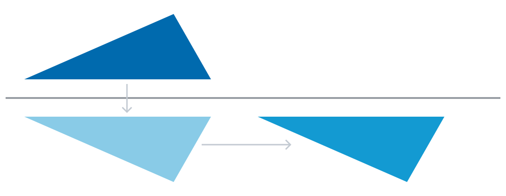
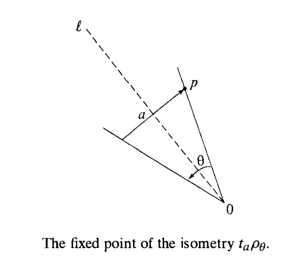
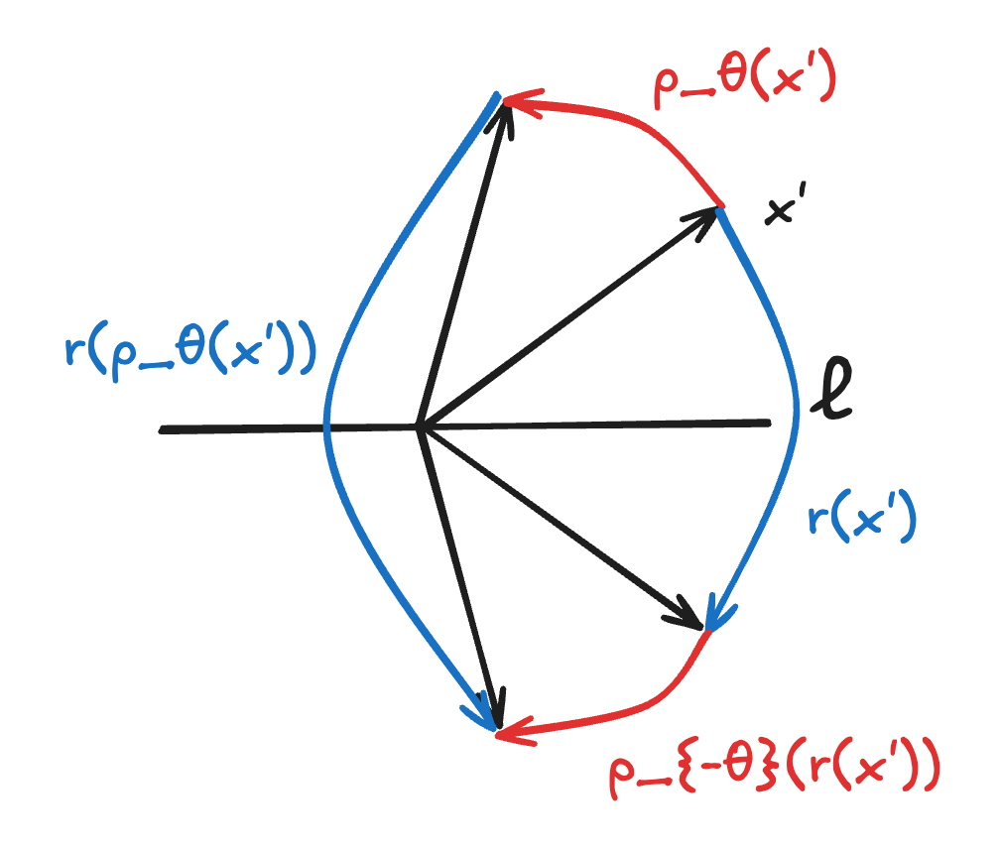

# Symmetry

[TOC]

## Isometries

The distance between points of $\R^{n}$ is the length $u - v$ of the vector $u - v$.

!!! info "Definition: Isometry"
    An *isometry* of $\R^{n}$ is a distance-preserving map $f: \R^n \to \R^{n}$ such that for all $u, \in \R^n$,

    $$
    |f(u) - f(v)| = |u - v|
    $$

An isometry will map a figure to a congruent figure.

!!! example "Example: Isometries"
    - Orthogonal linear operators are isometries. Since $\varphi$ is linear, it follows that $\varphi(u) - \varphi(v) = \varphi(u - v)$. Then,

        $$
        |\varphi(u - v)| = |u - v|
        $$

        hence orthogonal operators preserve distances.

    - Translation $t_a$ be a vector $a$, $t_a(x) = x + a$ is an isometry (as the vectors $a$ cancel out).

    - Composition of isometries is an isometry.

Recall the definition of an orthogonal matrix. $A$ is an orthogonal matrix provided that $A^T A = I \iff A^T = A^{-1} \iff Ax \cdot Ay = x \cdot y \iff \det(A) = \pm 1 \iff A$'s columns form an orthonormal basis of $R^n$.

Crucially, we will use the property of preserving dot-products, i.e. $Ax \cdot Ay$.

!!! tip "Theorem: Isometry Conditions"
    The following conditions on $\varphi: \R^n \to \R^n$ are equivalent.

    - a. $\varphi$ is an isometry that fixes the origin $\varphi(0) = 0$.
    - b. $\varphi(v) \cdot \varphi(w) = v \cdot w$ for all $v, w$.
    - c. $\varphi$ is an orthogonal linear operator.

We know that $c \implies a$.

!!! question "Lemma"
    Let $x, y \in \R^n$. If $x \cdot x = x \cdot y = y \cdot y$, then $x = y$.

!!! quote "Proof"
    Suppose $x \cdot x = x \cdot y = y \cdot y$. Then,

    $$
    (x - y) \cdot (x - y) = x \cdot x + y \cdot y - 2 x \cdot y = 0 \implies x = y
    $$

Now, we prove that $b \implies c$.

!!! quote "Proof"
    Let $\varphi$ be a map that preserves dot-products. Then, it will be orthogonal provided that it is a linear operator. So we need to show that $\varphi(cx) = c \varphi(x)$ and $\varphi(x + y) = \varphi(x) + \varphi(y)$.

    Suppose $w = u + v$. We want to show that $\varphi(w) = \varphi(u) + \varphi(v)$. To show this, it suffices to show that $\varphi(w) \cdot \varphi(w) = \varphi(w) \cdot (\varphi(u) + \varphi(v)) = (\varphi(u) + \varphi(v)) \cdot (\varphi(u) + \varphi(v))$.

    Then, it suffices to show that:

    $$
    \varphi(w) \cdot \varphi(w) = \varphi(w) \cdot \varphi(u) + \varphi(w) \cdot \varphi(v) = \varphi(u) \cdot \varphi(u) + \varphi(v) \cdot \varphi(v) + 2 \varphi(u) \cdot \varphi(v)
    $$

    Since $\varphi$ preserves dot-products, we just need to show that:

    $$
    w \cdot w = w \cdot u + w \cdot v = u \cdot u + v \cdot v + 2 u \cdot v
    $$

    Since $w = (u + v)$, we have that $w \cdot w = w \cdot (u + v) = (u + v) \cdot (u + v)$. Therefore, $\varphi(w) = \varphi(u) + \varphi(v)$.

    The proof for $\varphi(cv) = c \varphi(v)$ sets $u = cv$ and shows that $\varphi(u) = c \varphi(v)$ and is analogous.

Next, we show that $a \implies b$.

!!! quote "Proof"
    Let $\varphi$ be an isometry that fixes the origin. Then,

    $$
    (\varphi(u) - \varphi(v)) \cdot (\varphi(u) - \varphi(v)) = (u - v) \cdot (u - v)
    $$

    Substitute $v = 0$. Since $\varphi(0) = 0$, it follows that $\varphi(u) \cdot \varphi(u) = u \cdot u$. Similarly, $\varphi(v) \cdot \varphi(v) = v \cdot v$. Expanding, we get:

    $$
    \varphi(u) \cdot \varphi(u) + \varphi(v) \cdot \varphi(v) - 2 \varphi(v) \cdot \varphi(u) = u \cdot u + v \cdot v - 2 u \cdot v
    $$

    Canceling, we get:

    $$
    \varphi(v) \cdot \varphi(u) = u \cdot v
    $$

!!! warning "Corollary: Isometry Composition"
    Every isometry $f$ of $\R^n$ is the composition of an orthogonal linear operator and a translation. If $f$ is an isometry and $f(0) = a$, then $f = t_a \varphi$ where $t_a$ is a translation and $\varphi$ is an orthogonal linear operator. This expression for $f$ is unique.

!!! quote "Proof"
    Let $f$ be an isometry and $a = f(0)$. Let $\varphi = t_{- a} f$. Then, $t_a \varphi = f$. Since $\varphi$ is the composition of isometries $t_{- a}$ and $f$, it's an isometry. $\varphi$ also fixes the origin, $\varphi(0) = t_{-a} f(0) = t_{-a} a = 0$. Since $\varphi$ is an isometry which fixes the origin, it is an orthogonal linear operator. The expression $f = t_a \varphi$ is unique - since $\varphi(0) = 0$, we have $a = f(0) \implies \varphi = t_{- a} f$.

Can we compose isometries together? We know that the composition of orthogonal operators is an orthogonal operator.

Clearly, $t_a t_b = t_{a + b}$. We also have that $\varphi t_a = t_{\varphi(a)} \varphi$.

$$
\varphi t_a(x) = \varphi(a + x) = \varphi(a) + \varphi(x) = t_{\varphi(a)} \varphi(x)
$$

!!! warning "Corollary: Isometry Group"
    The set of all isometries of $\R^n$ forms a group $M_n$ with composition of functions as its law of composition.

!!! quote "Proof"
    The composition of isometries is an isometry. The inverse of an isometry is an isometry too since orthogonal operators and translations are invertible so if $f = t_a \varphi$, then

    $$
    f^{-1} = \varphi^{-1} t_a^{-1} = \varphi^{-1} t_{- a}
    $$

    This is a composition of isometries so $f^{-1}$ is an isometry.

    The composition of isometries:

    $$
    t_a \varphi t_b \phi (x) = t_a \varphi(b + \phi(x)) = a + \varphi(b) + \varphi \phi(x) = t_{a + \varphi(b)} \varphi \phi(x)
    $$

$O_n$ is the group of $n \times n$ orthogonal matrices (product of orthogonal matrices is orthogonal and the transpose (inverse) is orthogonal). $O_n$ is a subgroup of $\text{GL}_n$.

!!! success "Proposition: Homomorphism"
    There is a map $\pi: M_n \to O_n$ defined by dropping the translation part of an isometry. Specifically, if $f = t_a \varphi$, then $\pi(f) = \varphi$. This map $\pi$ is a surjective homomorphism where $\text{Ker}(\pi) = T = \{t_v\}$, the set of translations which is a normal subgroup of $M_n$.

!!! quote "Proof"
    It's clear that $\pi$ is surjective. We need to show that $\pi(fg) = \pi(f) \pi(g)$. Suppose $f = t_a \varphi, g = t_b \phi$. Then,

    $$
    \pi(f) \pi(g) = \varphi \phi
    $$

    $$
    \pi(fg) = \pi(t_a \varphi t_b \phi) = \pi(t_{a + \varphi(b)} \varphi \phi) = \varphi \phi
    $$

    Therefore, $\pi(fg) = \pi(f) \pi(g)$ so $\pi$ is a homomorphism.

Let $P$ be an $n$-dimensional space. The formula $t_a \varphi$ depends on the choice of coordinates. How does the formula change when coordinates are changed? We allow changes of coordinates via isometry.

Consider isometry $f, p \in P$ and $q = f(p)$. When we introduce coordinates $P$ is identified with $\R^n$ and $p, q$ have coordinates as $x = (x_1, \dots, x_n), y = (y_1, \dots, y_n)$. Then, $q = f(p)$ translates to $y = m(x) = t_a \varphi(x)$.

Let $\eta$ be the isometry performing a change of coordinates. Specifically, $\eta$ maps new coordinates back to the old coordinates. Then, the new coordinate vectors for $p, q$ are $x', y'$. Then, $m'$ for $f$ is $m'(x') = y'$. Substitute $\eta(x') = x, \eta(y') = y$ into the equation $m(x) = y$ obtaining $m \eta(x') = \eta(y') \implies \eta^{-1} m \eta(x') = y'$. So the new formula is the conjugate:

$$
m' = \eta^{-1} m \eta
$$

!!! warning "Corollary"
    The homomorphism $\pi: M_n \to O_n$ doesn't change when the origin is shifted by translation.

If $\eta = t_v$, then $m' = t_{- v} m t_v$. Since the translations are in the kernel of $\pi$ and since $\pi$ is a homomorphism, $\pi(m') = \pi(m)$.

Finally, we consider orientation. The determinant of orthogonal operator $\varphi$ on $\R^n$ is $\pm 1$. The operator is orientation-preserving if $\det(\varphi) = 1$ and orientation-reversing if $\det(\varphi) = -1$. Similarly, an isometry $f = t_a \varphi$ is called orientation-preserving or reverseing if $\varphi$ is orientation preserving or reversing.

The map $\sigma: M_n \to \{\pm 1\}$ that sends orientation-preserving isometries to $1$ and orientation-reserving isometries to $-1$ is a group homomorphism.

## Plane Isometries

We consider isometries of the plane. Let $M$ be the group of isometries of the plane. To compute in this group, we'll choose some special isometries as generators and obtain relations among them.

Recall - we say that a set $U$ generates a group $G$ provided that every element $g \in G$ can be expressed as a product of some string of elements in $U$.

Pick a coordinate system and identify the plane $P$ with $\R^2$. We choose as generators the translations, rotations around the origin and reflection across the $e_1$ axis. Let the rotation angle $\theta$ be written as $\rho_{\theta}$ and the reflection angle about the $e_1$ axis be $r$. These are linear operators.

1. Translation $t_a$ by a vector $t_a(x) = x + a$.

2. Rotation $\rho_{\theta}$ by $\theta$ about the origin is:

$$
\rho_{\theta} = \begin{bmatrix}
\cos \theta & - \sin \theta \\
\sin \theta & \cos \theta
\end{bmatrix}
$$

3. Reflection about the $e_1$-axis:

$$
r = \begin{bmatrix}
1 & 0 \\ 0 & -1
\end{bmatrix}
$$

These three elements $(t_a, \rho_{\theta}, r)$ can generate all other isometries (rotation about a point other than the origin, reflection about other lines, etc).

!!! tip "Theorem: Uniqueness"
    Let $m$ be an isometry of the plane. Then, $m = t_v \rho_{\theta}$ or $m = t_v \rho_{\theta} r$ for a uniquely determined vector $v$ and angle $\theta$.

!!! quote "Proof"
    Any isometry $m$ can be written uniquely as $m = t_v \varphi$ where $\varphi$ is an orthogonal operator. The orthogonal linear operators on $\R^2$ are the rotations $\rho_{\theta}$ and the reflections about lines through the origins, of the form $\rho_{\theta} r$.

An isometry of the form $t_v \rho_{\theta}$ preserves orientation while $t_v \rho_{\theta} r$ reverses orientation.

Computation can be done as follows:

- $\rho_{\theta} t_v = t_{\rho_{\theta}(v)} \rho_{\theta}$.
- $r t_v = t_{r(v)} r$
- $r \rho_{\theta} = \rho_{- \theta} r$
- $t_v t_w = t_{v + w}$. $\rho_{\theta} \rho_{\eta} = \rho_{\theta + \eta}$. $rr = 1$.

We now describe the plane isometries geometrically.

!!! tip "Theorem: Isometry Forms"
    Every isometry of the plane has one of the following forms.

    - Orientation-preserving: Translation, rotation.

    - Orientation-reversing: Reflection, glides (reflect along some line, then translate).

{ .center }

Glide Symmetry.

This theorem has interesting consequences - composing rotations about two different points is just a single rotation about a third point.

The composition of reflections about nonparallel lines $\ell_1, \ell_2$ is a rotation about the intersection point $p = \ell_1 \cap \ell_2$. This follows from the theorem since the composition is orientation-preserving and it fixes $p$. Composition of reflections about parallel lines is translation by a vector orthogonal to the lines.

!!! quote "Proof"
    Let $f$ be an isometry that preserves orientation but isn't a translation. Then, $f$ is a rotation about some point. We choose coordinates to write the formula for $f$ as $m = t_a \rho_{\theta}$. Since $m$ isn't a translation, $\theta \neq 0$.

!!! question "Lemma"
    An isometry $f$ with the form $m = t_a \rho_{\theta}$ where $\theta \neq 0$ is a rotation through $\theta$ about a point in the plane.

!!! quote "Proof"
    Let $\rho = \rho_{\theta}$. We change coordinates by a translation $t_p$. We wish to choose $p$ so that the new formula for $f$ becomes $m' = \rho$. Then, $f$ will be a rotation with $\theta$ about $p$.

    The rule is that $t_p(x') = x$ so $m' = t_{-p} m t_p = t_{-p} t_a \rho t_p = t_{a - p} \rho t_p$. Let $b = a - p + \rho(p)$ so $m' = t_b \rho$. We want to choose $p$ such that $b = 0$. We simply need to solve $p - \rho(p) = a$ or $(I - \rho) p = a$.

    Let $I$ be the identity, $c = \cos \theta$ and $s = \sin \theta$. Then,

    $$
    I - \rho = \begin{bmatrix}
    1 - c & s \\
    -s & 1 - c
    \end{bmatrix}
    $$

    with determinant $(1-c)^2 + s^2 = 1 - 2c + c^2 + s^2 = 2 - 2c$. This determinant is $0$ when $2 - 2 \cos \theta = 0$ or when $\theta = 0$. Since $\theta \neq 0$ (by assumption), the equation $(I - \rho)p = a$ has a unique solution for $p$.

The point $P$ is the fixed point of the isometry $t_a \rho_{\theta}$ and can be found geometrically.

Let $\ell$ pass through the origin and be perpendicular to $a$. Then, the sector with angle $\theta$ is bisected by $\ell$ and $p$ is determined by inserting $a$ into the sector.

{ .center }

We've completed the proof that all orientation-preserving isometries are either translations or rotations. Next, we show that all orientation-reversing isometries are either glides or a reflection.

To do this, we again change coordinates. The isometry $\rho_{\theta} r$ is a reflection about $\ell_0$ through the origin. We can rotate coordinates so that $\ell_0$ becomes the horizontal axis. Then, the reflection becomes the standard reflection $r$ and $t_a$ stays a translation in the new coordinate system. Then, $m = t_a r$ and operates like:

$$
m \begin{bmatrix} x_1 \\ x_2 \end{bmatrix} = t_a \begin{bmatrix} x_1 \\ - x_2 \end{bmatrix} = \begin{bmatrix}
x_1 + a \\ -x_2 + a
\end{bmatrix}
$$

This is precisely a glide - a reflection about the line $\ell = \{x_2 = \frac{1}{2} a_2\}$ followed by translation of $a_1 e_1$. If $a_1 = 0$, then $m$ is a reflection. QED.

!!! warning "Corollary"
    The glide line of the isometry $t_a \rho_{\theta} r$ is parallel to the line of reflection of $\rho_{\theta} r$.

Isometries that fix the origin are orthogonal linear operators. When coordinates are chose, the orthogonal group $O_2$ becomes a subgroup of the isometry group $M$. We can also consider the subgroup of $M$ of isometries which fix a point of the plane other than the origin. How are they related to the orthogonal group?

!!! success "Proposition"
    Suppose coordinates in the plane have been chosen so that the orthogonal group $O_2$ becomes the subgroup of $M$ of isometries that fix the origin. Then, the group of isometries that fix a point $p$ of the plane is the conjugate subgroup $t_p O_2 t_p^{-1}$.

!!! quote "Proof"
    Is an isometry $m$ fixes $p$, then, $t_p^{-1} m t_p$ fixes the origin. $t_p^{-1} m t_p o = t_p^{-1} m p = t_p^{-1} p = o$. Conversely, if $m$ fixes $o$, then $t_p m t_p^{-1}$ fixes $p$.

We can visualize rotation about $p$ as first translate by $t_{-p}$ to move $p$ to $0$, then rotate about the origin, then translate back to $p$.

We go back to the homomorphism $\pi: M \to O_2$.

!!! success "Proposition"
    Let $p$ be a point in the plane and $\rho_{\theta, p}$ be a rotation though $\theta$ about $p$. Then, $\pi(\rho_{\theta, p}) = \rho_{\theta}$. Similarly, if $r_{\ell}$ is a reflection about $\ell$ or a glide with glide line $\ell$ that is parallel to the $x$-axis, then $\pi(r_{\ell}) = r$.

**Points and Vectors**

Generally, there is no convincing reason to distinguish a point $p$ of the plane $P$ from the vector which goes from the origin $o$ to $p$. When working with isometries, we maintain the distinction. We introduce a copy of the plane, called $V$, and think of its elements as *translation vectors*. $t_v(p) = p + v$, shifting every point of the plane by $v$.

Suppose we shift coordinates in $P$ by a translation, $\eta = t_w$. Then, the rule is that $\eta(p') = p$ or $p' + w = p$. An isometry $m$ changes to $\eta^{-1} m \eta = t_{-w} m t_w$. Applying this rule with $m = t_v$, then $m' = t_{-w} t_v t_w = t_v$. The points of $P$ get new coordinates but the translation vectors are unchanged.

If we change coordinates by orthogonal operator $\varphi$, then $\varphi(p') = p$. If $m = t_v$, then $m' = \varphi^{-1} t_v \varphi = t_{\rho^{-1}(v)}$. So $\rho \rho^{-1}(v) = v$. The effect of change of coordinates is the same as $P$ on $V$. In other words, orthogonal operators act on $V$ but not on $P$ unless the origin is chosen.

## Finite Groups of Orthogonal Operators

### Cyclic, Dihedral Subgroups

!!! tip "Theorem: Characterizing Subgroup"
    Let $G$ be a finite subgroup of the orthogonal group $O_2$. There's an integer $n$ such that $G$ is one of the following groups.

    - $C_n$: The *cyclic group* of order $n$ generated by the rotation $\rho_{\theta}$ where $\theta = 2 \pi / n$.
    - $D_n$: The *dihedral group* of order $2n$ generated by elements $\rho_{\theta}$ where $\theta = 2 \pi / n$ and a reflection $r'$ about a line $\ell$ through the origin.

Generally, $n$ is how finely we can rotate around the unit circle. If $n = 4$, then $\theta$ corresponds to $90^{\circ}$. The $n$ rotations split the circle into $n$ equal steps. After $n$ rotations, we return to the start.

We describe the dihedral group $D_n$ before proving the theorem. We choose coordinates so that $\ell$ is the horizontal axis so the group simpy contains the standard reflection $r$ with matrix:

$$
\begin{bmatrix}
1 & \\
& -1
\end{bmatrix}
$$

If we write $\rho$ for $\rho_{\theta}$, then the $2n$ elements of the group are the $n$ powers of $\rho^i$ and the $n$ products $\rho^i r$. The rule is that:

$$
r \rho = \begin{bmatrix}
1 & \\
& -1
\end{bmatrix}
\begin{bmatrix}
c & -s \\
s & c
\end{bmatrix}
=
\begin{bmatrix}
c & s \\
-s & c
\end{bmatrix}
\begin{bmatrix}
1 & \\
& -1
\end{bmatrix}
= \rho^{-1} r
$$

If we first rotate and then reflect across the horizontal axis, that's equivalent to reflecting across the horizontal axis first and then rotating in the other direction by the same angle.

{ .center }

Let $x = \rho_{2 \pi / n}$ and $y = r$. Then,

!!! success "Proposition"
    The dihedral group $D_n$ has order $2n$, generated by elements $x, y$ that satisfy the relations:

    $$
    x^n = 1, \ y^2 = 1, \ yx = x^{-1} y
    $$

    The elements of $D_n$ are:

    $$
    1, x, \dots, x^{n - 1}; \ y, xy, x^2y, \dots, x^{n - 1} y
    $$

With the first two relations, we can re-write the third as:

$$
yx = x^{-1} y \implies xyx = y \implies yxyx = y^2 = 1
$$

or

$$
yx = x^{n - 1}y
$$

When $n = 3$, the relations are the same as $S_3$.

!!! warning "Corollary"
    The dihedral group $D_3$ and the symmetric group $S_3$ are isomorphic.

For $n \geq 3$, the dihedral and symmetric groups are not isomorphic since $D_n$ has order $2n$ and $S_n$ has order $n!$.

When $n \geq 3$, the elements of $D_n$ are orthogonal operators that take a $n$ sided polygon to itself, the group of symmetries of $\Delta$. A regular $n$-gon is carried to itself by rotation by $2 \pi / n$ about its center along with some reflections. The group of symmetries is $D_n$.

$D_1$ is the group $\{1, r\}$ meaning that it is a cyclic group like $C_2$. However, the element $r$ of $D_1$ is a reflection while the non-identity element of $C_2$ is rotation with angle $\pi$.

The group $D_2 = \{1, \rho, r, \rho r\}$ is isomorphic to the Klein four group (look it up!).

A subgroup $\Gamma$ of the additive group $\R^+$ is called *discrete* if there exists some small positive number $\epsilon$ such that every non zero element $c \in \Gamma$ has absolute value $\geq \epsilon$.

!!! question "Lemma"
    Let $\Gamma$ be a discrete subgroup of $\R^+$. Then, either $\Gamma = \{0\}$ or $\Gamma$ is the set $\Z a$ of integer multiples of $a$.

!!! quote "Proof"
    $a, b \in \Gamma \implies a - b \in \Gamma, |a - b| \geq \epsilon$. Therefore, a bounded interval contains a finite number of elements of $\Gamma$ in it since distinct elements are all separated by $\epsilon$ and only finitely many elements separated by $\epsilon$ can fit in the bounded interval.

    Suppose $\Gamma \neq \{0\}$. Then, $\exists b, -b \neq 0 \in \Gamma$. Let $a' > 0 \in \Gamma$. We choose the smallest positive element $a$ since we only need to choose the smallest element of the finite subset of $\Gamma$ in $0 \leq x \leq a'$.

    We show that $\Gamma = \Z a$. Since $a \in \Gamma$, $\Z a \subset \Gamma$. Let $b \in \Gamma$, then $b = ra$ where $r = m + r_0, m \in \Z, 0 \leq r_0 < 1$. Since $\Gamma$ is a group, $b' = b - ma \in \Gamma$, $b' = r_0 a$. Then, $0 \leq b' < a$. Since $a$ is the smallest element in $\Gamma, b' = 0 \implies b = ma$. Therefore, $\Gamma \subset \Z a \implies \Gamma = \Z a$.

Finally, we prove the theorem about finite subgroups of $O_2$.

!!! quote "Proof"
    Let $G$ be a finite subgroup of $O_2$. We want to show that $G$ is $C_n$ or $D_n$. All elements of $O_2$ are rotations $\rho_{\theta}$ or reflections $\rho_{\theta} r$.

    1. Suppose all elements of $G$ are rotations.

    We must show that $G$ is cyclic. Let $\Gamma$ be the set of real numbers $\alpha$ such that $\rho_{\alpha} \in G$. Then, $\Gamma$ is a subgroup of $\R^{+}$ and contains $2 \pi$. Since $G$ is finite, $\Gamma$ is discrete and has the form $\Z a$. Then, $G$ consists of integer multiples through $\alpha$. Since $2 \pi \in \Gamma$, it's a multiplier of $\alpha$. Therefore, $\alpha = 2 \pi / n$ for some $n$ and $G = C_n$.

    2. $G$ contains a reflection.

    Adjust coordinates to the standard reflection $r \in G$. Let $H$ be the subgroup consisting of rotations in $G$. We conclude $H$ is the cyclic group generated by $\rho_{\theta}$ for $\theta = 2 \pi / n$. Then, the products $\rho_{\theta}^{k}, \rho_{\theta}^{k} r$ are in $G$ so $G$ contains the dihedral group $D_n$. We claim $G = D_n$. Let $g \in G$. Then, $g$ is either a rotation or reflection. If $g$ is a rotation, then $g \in H \in D_N$. If $g$ isa reflection, then $g = \rho_{\theta} r$. Since $r \in G, gr = \rho_{\alpha} \implies \rho_{\alpha}$ is a power of $\rho_{\theta} \implies g \in D_n$.

### Fixed Point

!!! tip "Theorem: Fixed Point Theorem"
    Let $G$ be a finite group of isometries of the plane. There is a point in the plane $p$ fixed by every element of $G$, i.e. for $g \in G, g(p) = p$.

!!! quote "Proof"
    Let $s$ be a point in the plane and $S = \{g(s) \mid g \in G\}$. Naturally, $s \in S$ since $1(s) = s$.

    $S$ is called the *orbit* of $s$ for the action of $G$. Any element of $G$ simply permutes the orbit $S$. We will show that every isometry $g \in G$ sends $S$ onto itself.

    Consider $s' \in S, h \in G$. We want to show that $h(s') \in S$. Suppose $s' = g(s)$. Since $G$ is a group, $hg \in G$ and $hg(s) = h(s') \implies h(s') \in S$.

    Since $G$ is a group of isometries, $g \in G$ is injective and since we just showed that $g$ is surjective, each $g$ provides a bijection (or permutation) from $S$ to $S$.

    We list $S = \{s_1, \dots, s_n\}$. The fixed point is the centroied $p = \frac{1}{n} (s_1 + \dots + s_n)$.

!!! question "Lemma: Isometries Take Centroids to Centroids"
    Let $S = \{s_1, \dots, s_n\}$ be a finite set of points in the plane. and $p$ be its centroid. Let $m$ be an isometry. Let $m$ be an isometry, $m(p) = p'$. Then, $p'$ is the centroid of the set $S' = \{m(s_1), \dots, m(s_n)\}$.

Since $g$ permutes the orbit, it sends $S$ to $S$ and $p$ to $p$.

!!! quote "Proof"
    Suppose $m = t_a$ or $m = \varphi$. If $m = t_a$, then:

    $$
    p' = p + a = \frac{1}{n} ((s_1 + a) + \dots + (s_n + a)) = \frac{1}{n} (t_a(s_1) + \dots + t_a(s_n))
    $$

    If $m = \varphi$, then since $\varphi$ is a linear operator:

    $$
    p' = \varphi(p) = \varphi \frac{1}{n} (s_1 + \dots + s_n) = \frac{1}{n} (\varphi(s_1) + \dots + \varphi(s_n))
    $$

!!! warning "Corollary"
    Let $G$ be a finite subgroup of $M$ of isometries of the plane. Then, $G$ is one of the groups $C_n$ or $D_n$.

## Discrete Isometry Groups

Like a kaleidoscope, the union of group actions on a figure can form an interesting figure. Consider a random figure $R$. Each element of $g$ moves $R$ to some new position $gR$. The figure $F = \bigcup_{g \in G} gR$. $h$ sends to $gR$ to $hgR \in F$. If $R$ is sufficiently random, $G$ will be the group of symmetries of $F$.

Some subgroups of $M$ are too wild to have reasonable geometry.

!!! info "Definition: Discrete Groups"
    A group $G$ of isometries of the plane $P$ is *discrete* if it does not contain arbitrarily small translations or rotations. Specifically, $G$ is discrete is there exists $\epsilon \in \R_{\geq 0}$ so that:

    - If an element of $G$ is translation by non-zero vector $a$, then $|a| \geq \epsilon$.
    - If an element of $G$ is the rotation through $\theta$ about some point in the plane, then $|\theta| \geq \epsilon$.

Translations and rotations are all of the orientation-preserving isometries. Orientation-reversing isometries are also bounded below - if $m$ is a glide with nonzero glide vector $v$, then $m^2$ is the translation $t_{2v}$.

