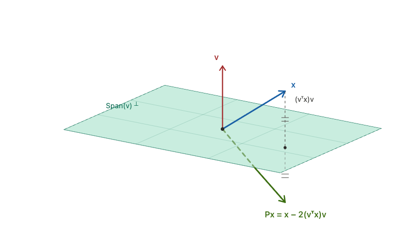

# QR Decomposition

We introduce the tools used in QR-decomposition - outer-products, projectors, and the product of Householder reflectors. These tools are frequently used to compute QR decompositions so we can review this problem as well.

We specifically review choice chapters from the QR-decomposition section of Trefethen & Bau.

## Projectors

!!! info "Definition: Projector"
    A *projector* is a square matrix that satisfies

    $$
    P^2 = P
    $$

    $P$ is also called idempotent. This definition includes both orthogonal and non-orthogonal projectors. Non-orthogonal projectors may be called *oblique projectors*.

As suggested by its name, a projector takes a vector $v$ and projects it onto a certain subspace (kind of like the shadow casted by $v$ on $\text{span}(P)$). Once we have projected $v$ onto $\text{span}(P)$, a secondary projection ought to do nothing, which is why we require that $P^2 = P$. Mathematically,

Suppose $v = Px$. Then,

$$
Pv = P(Px) = P^2x = Px = v
$$

Naturally, $Pv - v \in \text{Ker}(P)$. This is precisely the component of $v$ which is discarded by the projection.

### Complementary Projector

If $P$ is a projector, then $I - P$ is also a projector.

$$
(I - P)^2 = I - 2P + P^2 = I - P
$$

$I - P$ projects on the null-space of $P$. We have that:

!!! tip "Theorem: Image(I - P) = Kernel(P)"

!!! quote "Proof"
    Suppose $v \in \text{Ker}(P), v \neq 0$. Then, $Pv = 0$ and $(I - P)v = v - Pv = v - 0 = v$ so $v \in \text{Image}(I - P)$. Therefore, $\text{Ker}(P) \subseteq \text{Image}(I - P)$.

    Suppose $v \in \text{Image}(I - P)$. Then, $(I - P)v = v - Pv$. However, we know that $P$ maps $v - Pv$ to $0$ so $\text{Image}(I - P) \subseteq \text{Ker}(P)$ (the two spaces are comparable because $P$ is square).

    Therefore, $\text{Image}(I - P) = \text{Ker}(P)$.

Without too much effort, we can show that $\text{Ker}(I - P) = \text{Image}(P)$ as well and that $\text{Image}(P) \bigcap \text{Ker}(P) = \{0\}$.

In short, a projector separates the vector space into two subspaces. Let $S_1, S_2$ be subspaces of $\mathbb{C}^m$ such that $S_1 \bigcap S_2 = \{0\}$ and $\mathbb{C}^m = S_1 \oplus S_2$ (each vector in $\mathbb{C}^m$ can be uniquely expressed as a sum of $s_1 \in S_1$ and $s_2 \in S_2$). The pair $(S_1, S_2)$ is called complementary subspaces. There is a projector $P$ such that $\text{Image}(P) = S_1, \text{Ker}(P) = S_2$. We say that $P$ is a projector onto $S_1$ along $S_2$.

An application: Given $x \in \mathbb{C}^m$, what's the component of $x$ in the direction of a particular eigenvector $v$ of a matrix $A$ (which holds a complete set of eigenvectors)? The answer is $Px$ where $P$ is a particular rank-one projector.

Note that if $P$ is a rank $k$ projector, $I - P$ is a rank $n - k$ projector where $n$ is the number of rows / columns in $P$.

### Orthogonal Projector

!!! info "Definition: Orthogonal Projector"
    An **orthogonal projector** is one which projects onto a subspace $S_1$ along $S_2$ where $S_1, S_2$ are orthogonal.

    Orthogonal projectors don't need to be orthogonal matrices.

!!! tip "Theorem: Orthogonal Projectors are Symmetric"

!!! quote "Proof"
    Let $P$ be an orthogonal projector. We have that

    $$
    \text{Image}(P) \perp \text{Ker}(P)
    $$

    and

    $$
    \text{Image}(P) \perp \text{Image}(I - P)
    $$

    Suppose $Px_1 \neq 0, (I - P)x_2 \neq 0$. Then by orthogonality,

    $$
    (P x_1)^T ((I - P) x_2) = 0
    $$

    $$
    x_1^T P^T (I - P) x_2 = 0
    $$

    $$
    x_1^T P^T x_2  - x_1^T P^T P x_2 = 0
    $$

    $$
    x_1^T P^T x_2 = x_1^T P^T P x_2 \implies P^T = P^T P
    $$

    $$
    (P^T)^T = P = P^T
    $$

    Therefore, orthogonality of the projected subspaces implies that the orthogonal projector must be symmetric.


A particularly important kind of orthogonal projector is the rank-one orthogonal projector,

$$
P_q = qq^T
$$

The complement is the rank $m - 1$ orthogonal projector which removes the component in the direction of $q$,

$$
P_{\perp q} = I - qq^T
$$

For idempotency, it is assumed that $q$ has norm $1$. However, normalizing is not hard.

## QR Factorization

The goal of QR factorization is to construct a sequence of orthonormal matrices $q_1, q_2, \dots$ that spans the successive column spaces of some matrix $A$. More precisely, for $A \in \mathbb{C}^{m \times n}, m \geq n$, we want:

$$
\text{Span}(q_1, \dots, q_j) = \text{Span}(a_1, \dots, a_j)
$$

for $j = 1, \dots, n$. This amounts to the condition that:

$$
\left[\begin{array}{c|c|c|c}
a_1 & a_2 & \cdots & a_n
\end{array}\right]
=
\left[\begin{array}{c|c|c|c}
q_1 & q_2 & \cdots & q_n
\end{array}\right]
\begin{bmatrix}
r_{11} & r_{12} & \cdots & r_{1n} \\
       & r_{22} &        & \vdots \\
       &        & \ddots &        \\
       &        &        & r_{nn}
\end{bmatrix}
$$

The coefficients in $R$ express that a column $a_j$ can be represented as a linear combination $\sum_{i = 1}^j r_{ij} q_i$ of the orthonormal columns of $Q$. More generally, we have $A = QR$ where $Q$ is a $m \times n$ matrix with orthonormal columns and $R$ is a $n \times n$ upper-triangular matrix. This factorization is called the *reduced $QR$ factorization of $A$*.

### Gram-Schmidt

Orthogonalization can be achieved by removing components of past $q$'s and then normalizing. First, orthogonalization can be done like so:

$$
v_j = a_j - (q_1^T a_j) q_1 - (q_2^T a_j) q_2 - \dots - (q_{j - 1}^T a_j) q_{j - 1}
$$

Thus, to explicitly construct the $q$ vectors is to solve for $q_j$ from the sum $a_j = \sum_{i = 1}^j r_{ij} q_i$. Specifically,

$$
q_1 = \frac{a_1}{r_{11}}
$$

$$
q_2 = \frac{a_2 - r_{12} q_2}{r_{22}}
$$

$$
q_j = \frac{a_j - \sum_{i = 1}^{j - 1} r_{ij} q_j}{r_{jj}}
$$

This naturally produces a sequence of orthonormal vectors as it's removing the component of the previous $q$'s in the current $a$ and it's normalizing. Naturally, we have that $r_{ij} = q_i^T a_j$ and $|r_{jj}| = ||a_j - \sum_{i = 1}^{j - 1} r_{ij} q_i||_2$.

It can be shown that a unique QR factorization exists for each full rank matrix $A$.

Code:
```
def gram_schmidt(A: np.ndarray):
    n = A.shape[1]
    q = np.zeros_like(A)
    r = np.zeros((n, n), dtype=float)

    for i in range(n):
        components = np.zeros_like(A[:, i])
        a_i = A[:, i]
        for j in range(i):
            r_ij = a_i @ q[:, j].T
            r[j, i] = r_ij
            components += r_ij * q[:, j]

        diff = a_i - components
        norm = np.linalg.norm(diff)
        q[:, i] = diff / norm
        r[i, i] = norm

    return q, r
```

### Modified Gram-Schmidt

Interestingly, we can also do Gram-Schmidt via projectors.

$$
q_1 = \frac{P_1 a_1}{||P_1 a_1||}, q_2 = \frac{P_2 a_2}{||P_2 a_2||}, \dots, q_n = \frac{P_n a_n}{||P_n a_n||},
$$

$P_j$ is the orthogonal projector along $\text{Span}(q_1, \dots, q_{j - 1})$  where $P_{j = 1} = I$. We can represent it explicitly. Suppose $\hat{Q}_{j - 1} = [q_1 | q_2 | \dots | q_{j - 1}]$. Then,

$$
P_j = I - \hat{Q}_{j - 1} \hat{Q}_{j - 1}^T
$$

Naturally, we can re-write:
$$
P_j = I - \sum_{i = 1}^{j - 1} q_i \otimes q_i = I - \sum_{i = 1}^{j - 1} q_i q_i^T
$$

Then,
$$
P_j a_j = (I - \sum_{i = 1}^{j - 1} q_i q_i^T) a_j = a_j - \sum_{i = 1}^{j - 1} (q_i^T a_j) q_i
$$
which is precisely the equation for $v_j$.

The standard (numerically unstable) Gram-Schmidt algorithm computes a single orthogonal projection at a time, $v_j = P_j a_j$. It's intuitively clear that

$$
P_j = P_{\perp q_{j - 1}} \dots P_{\perp q_1}
$$

$$
v_j = \left ( \prod_{i = 1}^{j - 1} P_{\perp q_{i}} \right ) a_j
$$

This suggests an alternative, iterative way of computing Gram-Schmidt.

$$v_j^{(1)} = a_j$$

$$v_j^{(2)} = P_{\perp q_i} v_j^{(1)} = v_j^{(1)} - (q_1^T v_j^{(1)}) q_1$$

Generally, $v_j^{(i)} = P_{\perp q_{i - 1}} v_j^{(i - 1)}$. We can observe that this is equivalent to the standard Gram-Schmidt except that it builds the orthonormal vectors iteratively rather than sequentially.

The matrix form can also be written via triangular orthogonalization.

Consider $[a_1 | \dots | a_n]$. The $i$'th step of matrix GS normalizes the $i$'th column as $v_i = a_i / r_{ii}$ and subtracts $\frac{r_{ij}}{r_ii} a_i$ from the "future" columns $j > i$. This is the opposite order from standard GS - "future" columns are orthogonalized from the current column. This too can be represented as a triangular matrix. In the first step, we have:

$$
[a_1 | \dots | a_n] \begin{bmatrix}
\dfrac{1}{r_{11}} & - \dfrac{r_{12}}{r_{11}} & - \dfrac{r_{13}}{r_{11}} & \dots \\
& 1 & & \\
& & 1 & \\
& & & \ddots
\end{bmatrix}
= \begin{bmatrix}
q_1 | v_2^{(2)} | \dots | v_n^{(2)}
\end{bmatrix}
$$

On iteration $j$, column $i$ of the output matrix is (where $j < i < n$):

$$
v_i^{(j)} = v_i^{(j - 1)} - r_{ji} q_j = v_i^{(j - 1)} - \frac{r_{ji}}{r_{jj}} v_j^{(j)}
$$

We have:

$$
R_2 = \begin{bmatrix}
1 & & & \\
 & \dfrac{1}{r_{22}} & \dfrac{-r_{23}}{r_{22}} & \cdots \\
 & & 1 & \\
 & & & \ddots
\end{bmatrix}
$$

$$
R_j = \begin{bmatrix}
1 & & & & & \\
 & \ddots & & & & \\
 & & \dfrac{1}{r_{jj}} & \dfrac{-r_{j,j+1}}{r_{jj}} & \cdots & \dfrac{-r_{jn}}{r_{jj}} \\
 & & & 1 & & \\
 & & & & \ddots & \\
 & & & & & 1
\end{bmatrix}
$$

At the end, we have $A R_1 R_2 \dots R_n = \hat{Q}$.

Code:

```
def modified_gram_schmidt(A: np.ndarray):
    n = A.shape[1]
    v = A.copy()
    q = np.zeros_like(A)
    r = np.zeros((n, n), dtype=float)

    for i in range(n):
        r[i, i] = np.linalg.norm(v[:, i])
        q[:, i] = v[:, i] / r[i, i]

        for j in range(i + 1, n):
            r[i, j] = q[:, i] @ v[:, j]
            v[:, j] -= r[i, j] * q[:, i]

    return q, r
```

### Householder Triangularization

While Gram-Schmidt iteration applies successive triangular matrices to build:

$$
A R_1 R_2 \dots R_n = \hat{Q}
$$

where $R^{-1} = R_1 R_2 \dots R_N$, the product $\hat{R} = R_n^{-1} \dots R_2^{-1} R_1^{-1}$ is upper triangular and $A = \hat{Q} \hat{R}$ produces a reduced QR factorization of $A$.

The Householder method applies successive unitary matrices $Q_k$ to the left of $A$ to produces the upper triangular matrix $R$.

$$
Q_n \dots Q_2 Q_1 A = R
$$

where $Q^* = Q_n \dots Q_2 Q_1$ and the product $Q = Q_1^* Q_2^* \dots Q_n^*$ is unitary so $A = QR$ is a full QR factorization of $A$.

Thus Gram-Schmidt can be thought of as triangular orthogonalization while Householder is orthogonal triangularization.

!!! info "Definition: Householder Matrix"
    Let $v \in \mathbb{R}^m$. An $m \times m$ matrix $H$ of the form:

    $$
    H = I - \beta vv^T, \beta = \frac{2}{v^T v}
    $$

    is a *Householder reflection* and $v$ is the Householder vector.

Multiplying a vector $x$ by $H$ reflects $x$ about $\text{Span}(v)^{\perp}$. Basically, if $\beta$ had a $1$ in its numerator, then $H$ would send the $v$-component of vectors to $0$ ($\text{Image}(H) = \text{Span}(v)^{\perp}$). Since $\beta$ has a $2$, it doubles the subtraction and ends up reflecting about $\text{Span}(v)^{\perp}$.

Courtesty of MMIDS textbook & Claude:



!!! tip "Theorem: Householder reflections are orthogonal matrices"

!!! quote "Proof"
    Let $H = I - 2 \frac{vv^T}{v^T v}$. Let $a = \frac{vv^T}{v^T v}$ so $a^T = a$.

    $$
    H^T H = (I - 2a)^T (I - 2a) = (I - 2a) (I - 2a) = I + 4a - 4 a^T a = I + 4a - 4a = I
    $$

    Hence $H$ is orthogonal.


Like we stated earlier, one way to compute a QR-decomposition is to find a sequence of orthogonal matrices $H_1, \dots, H_m$ that triangularize $A$:

$$
H_m \dots H_2 H_1 A = R
$$

Then,

$$
A = H_1^T H_2^T \dots H_m^T H_m \dots H_2 H_1 A = H_1^T H_2^T \dots H_m^T R
$$

so $Q = H_1^T H_2^T \dots H_M^T$ is also orthogonal as it is a product of orthogonal matrices.

With a carefully chosen Householder vector, we can introduce $0$'s into $A$, thus iteratively triangularizing it. Set

$$
v_1 =||a_1|| e_1 - a_1
$$

$$
H_1 = I - 2 \frac{v_1 v_1^T}{v_1^T v_1}
$$

Drop the index. Call $||a_1|| = c \implies v = c e_1 - a_1$ where $e_1$ is the unit vector and $e_1^T a_1 = a_{11}$. Then,

$$
v^T a_1 = c e_1^T a_1 - a_1^T a_1 = c a_{11} - c^2 = -c (c - a_{11})
$$

$$
v^T v = (c e_1 - a_1)^T (c e_1 - a_1) = c^2 - 2 c a_1^T e_1 + a_1^T a_1
$$

$$
= c^2 - 2 c a_{11} + c^2 = 2c^2 - 2 c a{11} = 2c (c - a_{11})
$$

So:

$$
H_1 a_1 = a_1 - 2 v \frac{v^T a_1}{v^T v} = a_1 - 2 v \frac{-c (c - a_{11})}{2c (c - a_{11})}
$$

$$
= a_1 + v \implies H_1 a_1 = ||a_1|| e_1
$$

The first row of $H_1$ is $q_1$. Since $H_1$ is an orthogonal projector, $\text{Row One}(H_1) = H_1 e_1$. We have that $H_1 a_1 = ||a_1|| e_1$. Apply it again to get
$H_1 (||a_1|| e_1) = ||a_1|| H_1 e_1 = a_1 \implies H_1 e_1 = \dfrac{a_1}{||a_1||} = q_1^T$. Therefore, the $j$'th element in the first row of $H_1 A$ is $q_1^T a_j$ which is precisely what we want in $R$.

The goal for successive Householder reflectors is to leave the first few rows alone and only affect subsequent rows. Generally, we want:

$$
H_k = \begin{bmatrix}
I_{k - 1 \times k -1} & \mathbf{0} \\
\mathbf{0} & F_k
\end{bmatrix}
$$

where $F_k = I_{(n - k + 1) \times (n - k + 1)} - 2 \dfrac{v_k v_k^T}{v_k^T v_k}$, $v_k = ||a_k|| e_{n - k + 1} - a_k$. The action is to preserve the existing rows (applying the identity matrix to them) while completing the $k$'th row of $R$.

This amounts to a sequential change of basis.

Code:
```
def householder_explicit(A: np.ndarray):
    m, n = A.shape
    W = A.astype(float)

    Q = np.eye(m)

    for k in range(min(n, m - 1)):
        x = W[k:, k]
        x_norm = np.linalg.norm(x)
        if x_norm == 0.0:
            continue

        v = x.copy()
        v[0] += np.sign(x[0]) * x_norm
        v /= np.linalg.norm(v)

        H_k = np.eye(m)
        H_k[k:, k:] -= 2.0 * np.outer(v, v)

        W = H_k @ W
        Q = Q @ H_k

    R = np.triu(W)

    return Q, R
```

#### WY-Trick

Instead of actually doing the matrix-multiplies explicitly, we can represent the product of Householder matrices implicitly. 

## Appendix

Finally, we review outer-products.

### Outer Products

!!! tip "Theorem: "
    Matrix multiplication can be expressed as a sum of outer products.

!!! quote "Proof"
    Consider the generic $AB$ matrix multiplication.

    $$
    AB = \begin{bmatrix}
    a_{11} & \dots & a_{1N} \\
    \vdots & \ddots & \vdots \\
    a_{M1} & \dots & a_{MN} \\
    \end{bmatrix}
    \begin{bmatrix}
    b_{11} & \dots & b_{1P} \\
    \vdots & \ddots & \vdots \\
    b_{N1} & \dots & b_{NP} \\
    \end{bmatrix} = C
    $$

    $$
    c_{kl} = \sum_{i = 1}^N a_{ki} b_{il}
    $$

    The **outer-product** of two vectors is defined as:

    $$
    a_i \otimes b_j = ab^T = \begin{bmatrix}
    a_1 \\ \vdots \\ a_N
    \end{bmatrix} \otimes
    \begin{bmatrix}
    b_1 \\ \vdots \\ b_M
    \end{bmatrix} =
    \begin{bmatrix}
    a_1 b_1 & \dots & a_1 b_M \\
    \vdots & \ddots & \vdots \\
    a_N b_1 & \dots & a_N b_M \\
    \end{bmatrix}
    $$

    Let $C' = a_i \otimes b_j$. Then, $C'_{kl} = a_k b_l$.

    Generally, we can express:

    $$
    AB =
    \begin{bmatrix}
    a_1 | \dots | a_N
    \end{bmatrix}
    \begin{bmatrix}
    & b_1 & \\
    \hline
    & \vdots & \\
    \hline
    & b_N &
    \end{bmatrix}
    = C = \sum_{i = 1}^N a_i \otimes b_i^T
    $$

    In other words, a matrix-multiply can be expressed as a sum of rank-one outer-products. To see this, observe that:

    $$
    C_{kl} = [\sum_{i = 1}^N a_i \otimes b_i^T]_{kl}
    $$

    $$
    = \sum_{i = 1}^N (a_i \otimes b_i^T)_{kl}
    $$

    $$
    = \sum_{i = 1}^N a_{ki} b_{il}
    $$

    This is identical to the element-wise formula given by the regular process for matrix multiplication and holds for generic indices.

### References

https://mmids-textbook.github.io/chap02_ls/04_qr/roch-mmids-ls-qr.html

Trefethen & Bau

Golub & Van Loan

Songlin Yang